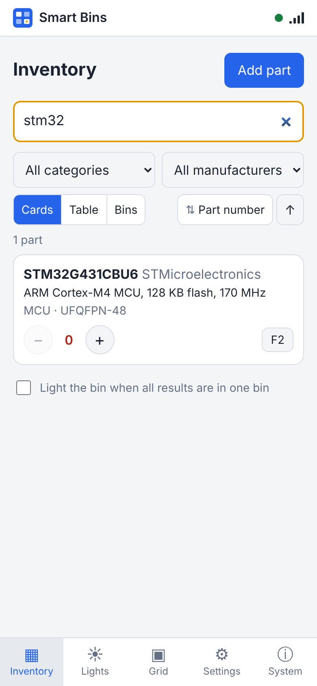
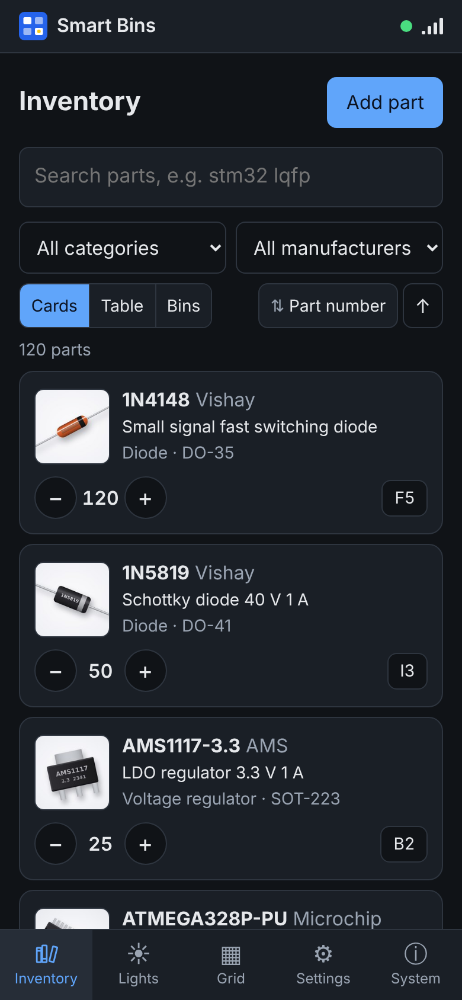
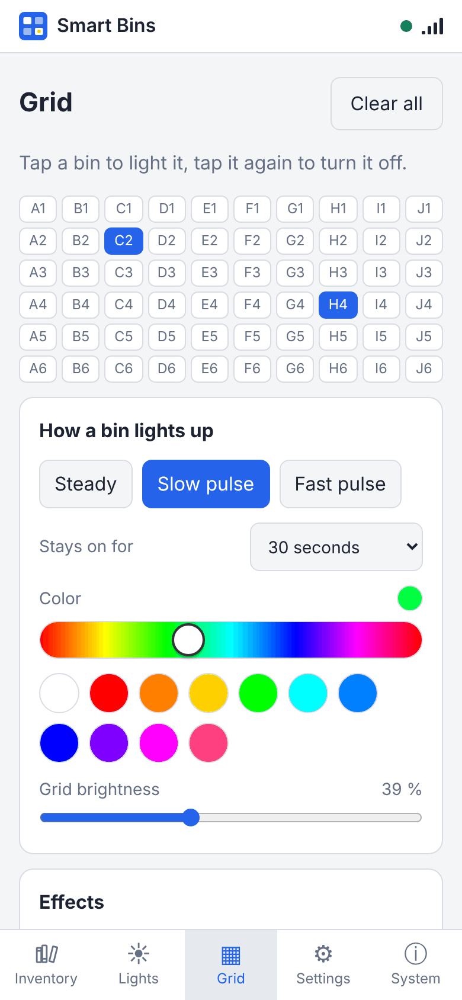
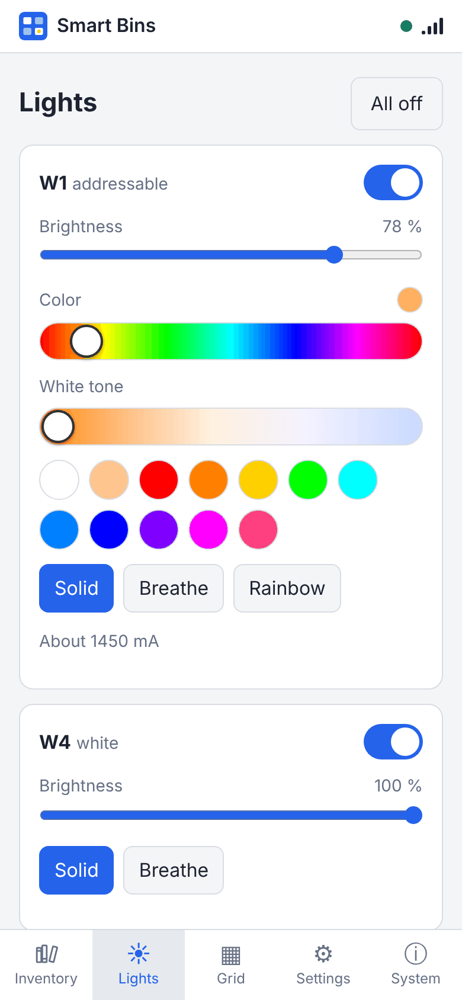

# Smart Bins

Un almacén de componentes con cajones iluminados para el taller, basado en el ESP32.

Smart Bins es una cuadrícula de cajones de plástico, cada uno iluminado por 1–8 LED direccionables. Una página web en el móvil lleva el inventario de sus componentes en una base de datos SQLite en la memoria flash del ESP32. Busque una pieza (por ejemplo `STM32`) y se ilumina el cajón donde está guardada.

## Funciones

- Cuadrícula de cajones de cualquier tamaño, 1–8 píxeles por cajón, cableada en zigzag o fila a fila, en una o dos líneas de datos; se configura desde el navegador, con patrones de prueba para comprobar el cableado
- Inventario en SQLite en la placa: búsqueda mientras escribe en todos los campos, filtros, orden, botones **+ / −** para la cantidad y una vista de cajones con los resultados
- Una foto por pieza, hecha con la cámara del móvil, guardada en la flash o en una tarjeta microSD
- Copia de seguridad y restauración de todo (piezas, fotos, ajustes) en un solo archivo; exportación e importación CSV
- Luces de trabajo: una tira RGB analógica, o hasta 3 tiras direccionables o blancas regulables, más 2 tiras blancas; cada cambio es gradual
- Efectos de luz en la cuadrícula (fuego, chispas, relax, demo) y efectos musicales con un micrófono I2S o analógico
- Página de configuración Wi-Fi, dirección `smartbins.local`, actualización del firmware desde el navegador, contraseña opcional
- Inglés, español y ruso; tema claro y oscuro

## Hardware

- Una ESP32-DevKitC con un módulo **ESP32-WROOM-32E/UE-N16R2** (16 MB de flash, 2 MB de PSRAM), o un ESP32-WROOM-32 normal con 4, 8 o 16 MB de flash
- Tiras LED direccionables: WS2812 / WS2812B / SK6812 (5 V) o WS2811 / WS2815 (12/24 V)
- Un adaptador de nivel 74HCT245, interruptores MOSFET, una fuente para los LED (5, 12 o 24 V)
- Opcional: micrófono INMP441 (I2S) o MAX9814 (analógico), tarjeta microSD

Esquemas, cableado, lista de componentes y consumo: [docs/hardware/README.md](docs/hardware/README.md) (en inglés).

## Primeros pasos

1. **Monte el circuito:** [referencia de hardware](docs/hardware/README.md).
2. **Instale el firmware:** descargue el archivo para su placa de las [versiones publicadas](https://github.com/DmitryMuravyev/Smart-Bins/releases) y grábelo desde el navegador, sin instalar nada: [Installing the firmware](docs/flashing.md).
3. **Conéctela a la Wi-Fi** y abra **http://smartbins.local/**: [User guide](docs/user-guide.md).

La interfaz web está en español; la documentación detallada, por ahora, en inglés.

## Documentación

| Documento | Contenido |
|---|---|
| [User guide](docs/user-guide.md) | Primer arranque, las páginas, configuración de la cuadrícula y las luces, copias de seguridad, solución de problemas |
| [Installing the firmware](docs/flashing.md) | Qué archivo para qué placa, grabación desde el navegador o la línea de comandos, actualizaciones, compilación |
| [Hardware reference](docs/hardware/README.md) | Circuito, asignación de pines, alimentación, lista de componentes |
| [HTTP API](docs/api.md) | La API JSON que usa la página, para scripts y domótica |
| [Development notes](docs/development.md) | Estructura del proyecto |
| [Plan](docs/PLAN.md) | Decisiones y lista de tareas |

## Licencia

[MIT](LICENSE) © 2026 Dmitry Muravyev
