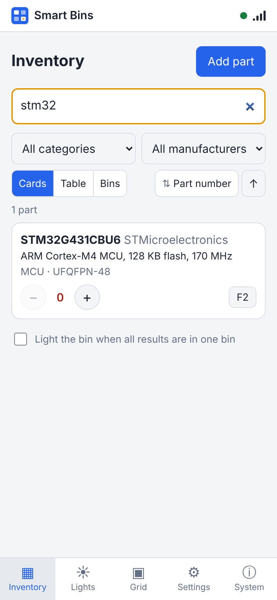
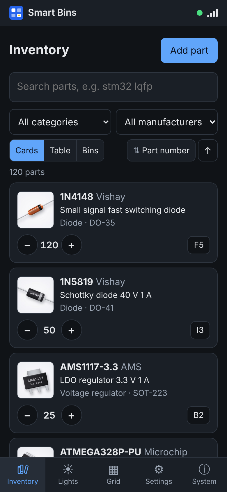
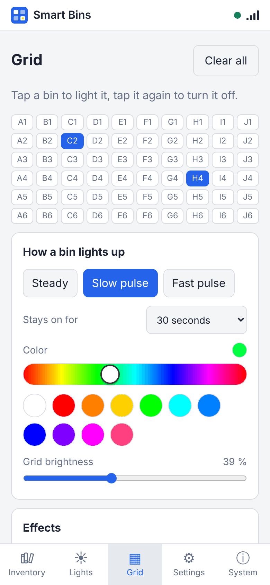
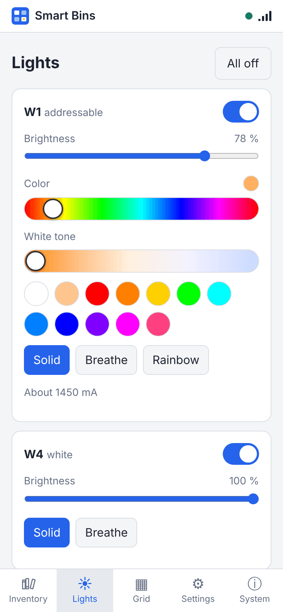

# Smart Bins

**English** · [Español](README.es.md) · [Русский](README.ru.md)

An addressable parts library for the home lab, built on the ESP32.

Smart Bins is a grid of plastic storage bins, each one lit by 1–8 addressable LEDs. A web page on your phone keeps the inventory of your components in a SQLite database on the ESP32's flash. Search for a part (for example `STM32`), and the bin where it is stored lights up.

## Features

- A bin grid of any size, 1–8 pixels per bin, wired in a zigzag or row by row, on one or two data lines; set up from the browser, with test patterns to check the wiring
- Inventory in SQLite on the board: search as you type across every field, filters, sorting, **+ / −** quantity buttons, a bin view of the search results
- A photo per part, taken with the phone's camera, stored in flash or on a microSD card
- Backup and restore of everything (parts, photos, settings) as one file, CSV export and import
- Workspace lights: an analog RGB strip, or up to 3 addressable or dimmable white strips, plus 2 white strips; every change fades
- Lighting effects on the grid (fire, sparks, relax, demo) and music effects with an I2S or analog microphone
- Wi-Fi setup page, `smartbins.local` address, firmware updates from the browser, optional password
- English, Spanish and Russian; light and dark theme

## Hardware

- An ESP32-DevKitC with an **ESP32-WROOM-32E/UE-N16R2** (16 MB flash, 2 MB PSRAM), or a plain ESP32-WROOM-32 with 4, 8 or 16 MB flash
- Addressable LED strips: WS2812 / WS2812B / SK6812 (5 V) or WS2811 / WS2815 (12/24 V)
- A 74HCT245 level shifter, MOSFET power switches, an LED power supply (5, 12 or 24 V)
- Optional: INMP441 (I2S) or MAX9814 (analog) microphone, microSD card

Schematics, wiring, parts list and power budget: [docs/hardware/README.md](docs/hardware/README.md).

## Getting started

1. **Build the circuit:** [Hardware reference](docs/hardware/README.md).
2. **Install the firmware:** download the file for your board from the [releases](https://github.com/DmitryMuravyev/Smart-Bins/releases) and write it from the browser, no tools needed: [Installing the firmware](docs/flashing.md).
3. **Connect it to Wi-Fi** and open **http://smartbins.local/**: [User guide](docs/user-guide.md).

## Documentation

| Document | What's in it |
|---|---|
| [User guide](docs/user-guide.md) | First start, the pages, setting up the grid and lights, backups, troubleshooting |
| [Installing the firmware](docs/flashing.md) | Which file for which board, flashing from the browser or the command line, updates, building from source |
| [Hardware reference](docs/hardware/README.md) | Circuit, pin map, power, parts list |
| [HTTP API](docs/api.md) | The JSON API the page uses, for scripts and home automation |
| [Development notes](docs/development.md) | Project layout and how the pieces fit |
| [Plan](docs/PLAN.md) | Decisions and the task list |

## License

[MIT](LICENSE) © 2026 Dmitry Muravyev
