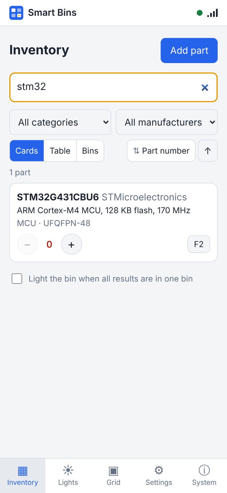
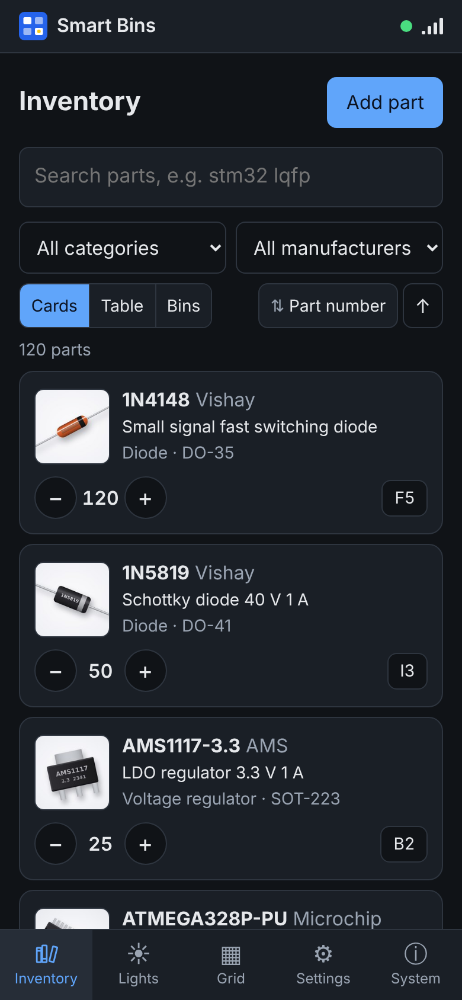
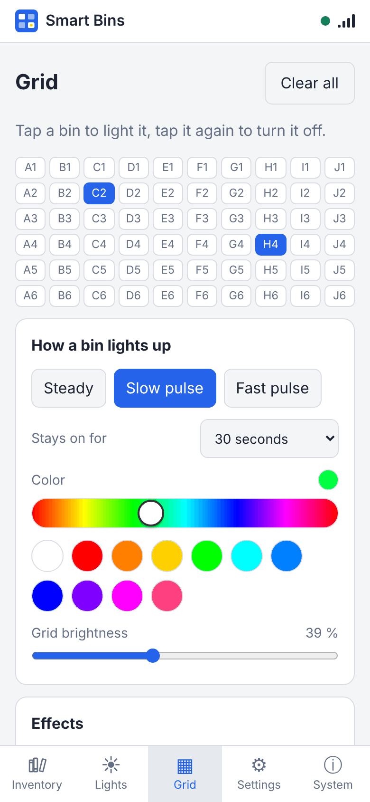
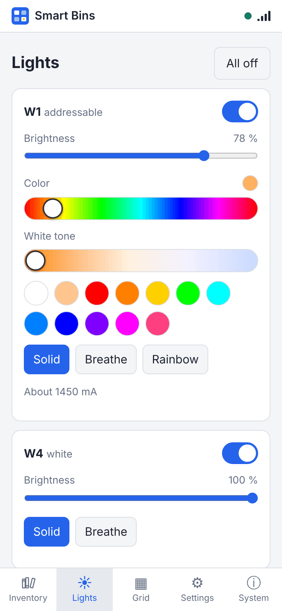

# Smart Bins

Хранилище радиодеталей с подсвечиваемыми ячейками для домашней лаборатории на ESP32.

Smart Bins — это сетка пластиковых ячеек, каждая из которых подсвечивается 1–8 адресными светодиодами. Веб-страница на телефоне ведёт учёт компонентов в базе данных SQLite во флеш-памяти ESP32. Найдите деталь (например, `STM32`), и ячейка, где она лежит, загорится.

## Возможности

- Сетка ячеек любого размера, 1–8 пикселей на ячейку, змейкой или построчно, на одной или двух линиях данных; настраивается в браузере, есть тестовые режимы для проверки разводки
- Склад в SQLite на самой плате: поиск по мере ввода по всем полям, фильтры, сортировка, кнопки **+ / −** для количества, вид результатов поиска на сетке ячеек
- Фото для каждой детали, снятое камерой телефона, хранится во флеш-памяти или на карте microSD
- Резервная копия и восстановление всего (детали, фото, настройки) одним файлом, экспорт и импорт CSV
- Рабочий свет: аналоговая RGB-лента или до 3 адресных либо белых диммируемых лент, плюс 2 белые ленты; любое изменение плавное
- Световые эффекты на сетке (огонь, искры, релакс, демо) и музыкальные эффекты с I2S- или аналоговым микрофоном (платы с PSRAM)
- Страница настройки Wi-Fi, адрес `smartbins.local`, обновление прошивки из браузера, пароль по желанию
- Английский, испанский и русский языки; светлая и тёмная тема

## Оборудование

- ESP32-DevKitC с модулем **ESP32-WROOM-32E/UE-N16R2** (16 МБ флеш-памяти, 2 МБ PSRAM) или обычный ESP32-WROOM-32 с 4, 8 или 16 МБ флеш-памяти
- Адресные светодиодные ленты: WS2812 / WS2812B / SK6812 (5 В) или WS2811 / WS2815 (12/24 В)
- Преобразователь уровней 74HCT245, MOSFET-ключи питания, блок питания для светодиодов (5, 12 или 24 В)
- По желанию: микрофон INMP441 (I2S) или MAX9814 (аналоговый), карта microSD

Схемы, подключение, список компонентов и расчёт питания: [docs/hardware/README.md](docs/hardware/README.md) (на английском).

## С чего начать

1. **Соберите схему:** [описание оборудования](docs/hardware/README.md).
2. **Установите прошивку:** скачайте файл для своей платы из [релизов](https://github.com/DmitryMuravyev/Smart-Bins/releases) и запишите его прямо из браузера, ничего не устанавливая: [Installing the firmware](docs/flashing.md).
3. **Подключите плату к Wi-Fi** и откройте **http://smartbins.local/**: [User guide](docs/user-guide.md).

Веб-интерфейс переведён на русский; подробная документация пока на английском.

## Документация

| Документ | Содержание |
|---|---|
| [User guide](docs/user-guide.md) | Первый запуск, страницы интерфейса, настройка сетки и света, резервные копии, решение проблем |
| [Installing the firmware](docs/flashing.md) | Какой файл для какой платы, запись из браузера или командной строки, обновления, сборка из исходников |
| [Hardware reference](docs/hardware/README.md) | Схема, распределение выводов, питание, список компонентов |
| [HTTP API](docs/api.md) | JSON API, которым пользуется страница, для скриптов и умного дома |
| [Development notes](docs/development.md) | Структура проекта |
| [Plan](docs/PLAN.md) | Решения и список задач |

## Лицензия

[MIT](LICENSE) © 2026 Dmitry Muravyev
