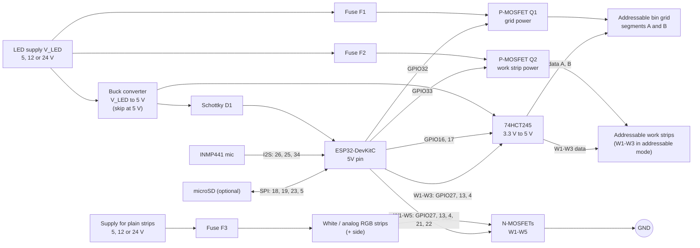

# Smart Bins hardware reference

This is the reference circuit for Smart Bins on an **ESP32-DevKitC** (ESP32-WROOM-32, 8 or 16 MB flash). It covers the addressable bin grid, the work lights, the microphone and the optional microSD card. Every block can be built on perfboard; a PCB can come later.

The grid's LED supply can be **5, 12 or 24 V**, depending on the strips (section 3). The reference build uses 12 V WS2815 or WS2811 strips, 10 × 6 bins with 2 pixels per bin.

The default pin map lives in [`lib/Board/src/PinMap.h`](../../lib/Board/src/PinMap.h). The firmware checks it at compile time and prints it at boot. From Task 14 on, pins and channel modes can be changed from the web UI.

> **Safety first:** LED strips draw many amps. Fuse every supply branch, use wire rated for the current, and never power a grid through the DevKitC's USB port.

---

## 1. Block diagram



All grounds (LED supply, plain-strip supply, ESP32) are joined at one point near the LED supply. The plain-strip supply can be the same unit as the LED supply when the voltages match.

---

## 2. Pin map

| Priority | Function | GPIO | Direction | Circuit |
|---|---|---|---|---|
| 1 | Grid data A | 16 | out | 74HCT245 → 330 Ω → grid segment A |
| 1 | Grid data B | 17 | out | 74HCT245 → 330 Ω → grid segment B |
| 1 | Grid power enable | 32 | out | Q1 high-side switch (section 5) |
| 2 | Work channel W1 | 27 | out | universal: N-MOSFET **and** 74HCT245 |
| 2 | Work channel W2 | 13 | out | universal |
| 2 | Work channel W3 | 4 | out | universal |
| 2 | Work strip power enable | 33 | out | Q2 high-side switch, for addressable work strips |
| 3 | White channel W4 | 21 | out | N-MOSFET only |
| 3 | White channel W5 | 22 | out | N-MOSFET only |
| 3 | Microphone I2S SCK / WS / SD | 26 / 25 / 34 | out / out / in | INMP441 |
| 3 | Analog microphone (instead of I2S) | 35 | in (ADC1) | MAX9814 |
| – | microSD SCK / MISO / MOSI / CS | 18 / 19 / 23 / 5 | SPI | optional |
| – | Button (clear highlight, factory reset) | 0 | in | on-board BOOT button |
| – | Status LED | 2 | out | on-board LED |
| – | Spare | 14, 15, 36, 39 (input-only) | | |

Pins to avoid: **GPIO6–11** (internal flash), **GPIO1/3** (USB serial), **GPIO12** (sets flash voltage at boot; pulled high, the board won't start), **GPIO34–39** as outputs (input-only). The firmware's pin validator rejects all of these.

### Work-light options

W1–W3 are wired to both an N-MOSFET (plain strips) and a 74HCT245 input (addressable strips). W4–W5 have only the N-MOSFET. Each channel's mode is a setting, so the same board covers both options:

| Option | W1 | W2 | W3 | W4, W5 |
|---|---|---|---|---|
| 1. Analog RGB strip + white strips | R | G | B | white |
| 2. Universal channels + white strips | addressable **or** white | addressable **or** white | addressable **or** white | white |

---

## 3. Supported LED strips

| Chipset | Strip voltage | Pixel | Notes |
|---|---|---|---|
| WS2812 / WS2812B | 5 V | 1 LED | most common; needs power injection every ~1 m |
| SK6812 (RGB / RGBW) | 5 V | 1 LED | RGBW adds a white die |
| WS2815 | 12 V | 1 LED | backup data line: if one pixel dies the rest keep working |
| WS2811 (12 V strip) | 12 V | 1 IC driving 3 LEDs | a pixel is a segment, often 5–10 cm long |
| WS2811 (24 V strip) | 24 V | 1 IC driving 6 LEDs | longer segments |

- All of them want a **5 V data signal**, whatever the strip voltage, so the same level shifter serves every type.
- **WS2815:** each pixel has a data input (DI) and a backup input (BI). At the start of each segment connect **BI to GND** and DI to the level shifter.
- **WS2811 strips:** check that the pixel length fits your bin pitch. With 2 pixels per bin, a 10 cm segment needs bins at least 20 cm wide; otherwise use 1 pixel per bin, or pick a strip with shorter segments.
- 12/24 V strips draw much less current for the same light than 5 V strips, and need far less power injection. That's why they're recommended for larger grids.
- The chipset, colour order and strip voltage are settings in the firmware (Task 3).

---

## 4. Level shifter (U1, 74HCT245)

The ESP32 outputs 3.3 V; the strips need at least about 3.5 V on data. A 74**HCT**245 powered from 5 V accepts 3.3 V as a logic high and outputs clean 5 V edges. (Use HCT, not HC: HC needs 3.5 V at its inputs.)

```
                 74HCT245 (U1)
               +-------------+
   +5V --------| 20 VCC      |
   GND --------| 10 GND      |
   +5V --------|  1 DIR      |   DIR high: A -> B
   GND --------| 19 /OE      |   always enabled
               |             |
 GPIO16 -------|  2 A1  B1 18|---[330R]---> grid segment A DIN
 GPIO17 -------|  3 A2  B2 17|---[330R]---> grid segment B DIN
 GPIO27 (W1) --|  4 A3  B3 16|---[330R]---> W1 addressable connector
 GPIO13 (W2) --|  5 A4  B4 15|---[330R]---> W2 addressable connector
 GPIO4  (W3) --|  6 A5  B5 14|---[330R]---> W3 addressable connector
   GND --------|  7 A6  B6 13|--- n.c.
   GND --------|  8 A7  B7 12|--- n.c.
   GND --------|  9 A8  B8 11|--- n.c.
               +-------------+
   100 nF ceramic from pin 20 to pin 10, as close to the chip as possible
```

- U1 runs from 5 V: the DevKitC's 5V pin (USB or buck converter), never from 12/24 V.
- Put the 330 Ω resistors at the shifter end of the data wire. They damp ringing on long cables and protect the first pixel.
- Keep data wires short (under ~1 m) and run a ground wire alongside each one. For longer runs, place the shifter near the strip or use a twisted pair (data + GND).
- Unused inputs (A6–A8) are tied to GND so they don't float.

### Breadboard prototype

For a breadboard test any of these works:
- **A 74HCT245 or 74HCT125 in DIP package.** It plugs straight into the breadboard and is the most reliable choice.
- **Two-transistor non-inverting shifter** (e.g. 2 × BC547 or 2N3904, or 2N7002 + BC557). A **single** transistor stage inverts the signal. The ESP32 can invert an output pin in hardware, so the firmware can offer an "invert data" option for that case (Task 4), but it's easy to forget, so a non-inverting stage is preferred.
- **BSS138 "bidirectional" modules:** their 10 kΩ pull-ups give slow rising edges. They often work at 800 kHz over short wires, but can flicker. Fine for a quick test, not for the final build.
- **No shifter at all** sometimes works with 5 V strips over a few centimetres of wire, but isn't reliable. Don't count on it.

---

## 5. Power switches for addressable strips (Q1 grid, Q2 work strips)

A high-side P-MOSFET disconnects the strip's V_LED. That removes the idle current of every pixel (about 1 mA each, even when dark), lets the firmware cut power on a fault, and keeps strips dark while the ESP32 boots.

```
   V_LED (after fuse F1) ---+----------------+
                            |                |
                         R1 10k   ZD1 15V    S
                            |   (cathode     |
                            |    to S)       |
                            +--------------G Q1  AO4407A (P-MOSFET)
                            |                |
                            R2               D
                     (see table)             |
                            |                +----> V_LED switched, to grid strips
                            C                       (1000 uF capacitor at each strip input)
   GPIO32 --[1k]--+-----B   Q3  BC547 / 2N3904 (NPN)
                  |         E
                [10k]       |
                  |         |
   GND -----------+---------+
```

| V_LED | R2 | Gate drive (V_GS) | Q1 |
|---|---|---|---|
| 5 V | 0 Ω (wire link) | −5 V | AO4407A |
| 12 V | 10 kΩ | −6 V | AO4407A |
| 24 V | 27 kΩ | −6.5 V | AOD4185 (−40 V) or another P-MOSFET rated ≥ 40 V |

- GPIO32 high → Q3 on → R1/R2 divide V_LED and pull the gate below the source → grid powered.
- GPIO32 low, floating or ESP32 in reset → Q3 off → R1 holds the gate at the source → grid off. That's the safe default.
- R2 keeps V_GS inside the MOSFET's ±20 V limit at 12/24 V. ZD1 (15 V zener between gate and source, cathode to source) clamps voltage spikes on the gate. It does not replace R2: always fit the R2 from the table.
- **AO4407A** (SO-8, −30 V, 12 A, about 20 mΩ at −4.5 V gate drive) handles up to about 6 A comfortably. Mount it on an SO-8 adapter with generous copper. At 12/24 V the currents are small (the reference grid draws at most about 3 A), so it runs cool. Avoid IRF9540 and IRF4905-class parts at 5 V: they need −10 V gate drive.
- Q2 (addressable work strips, GPIO33) is the same circuit. Leave it out if no work strip is addressable.
- **Phantom power:** while a strip is switched off, its data line must stay low, or the pixel's data input will power the strip through its protection diode. The firmware holds every data line low while its power switch is off.
- **Smooth transitions:** the firmware switches the power on before a fade-in starts and off only after a fade-out has finished, so normal on/off is always smooth. Only a fault or power loss cuts it instantly.

---

## 6. Plain work-light channels (N-MOSFET, W1–W5)

Plain white and analog RGB strips (5, 12 or 24 V) are dimmed by switching their minus side with a logic-level N-MOSFET. The ESP32's LEDC hardware PWM runs at about 19.5 kHz with 12-bit resolution, so there is no visible flicker (even on camera) and no audible whine. Fades are gamma-corrected so they look even to the eye.

```
   V_STRIP (after fuse F3) ----------------> strip +
                                             strip - (or R / G / B)
                                                 |
                                                 D
   GPIO27 (W1) --[100R]--+------------------ G  Q4  N-MOSFET
                         |                       S
                       [10k]                     |
                         |                       |
                        GND ---------------------+---- GND (common)
```

- **AO3400A** (SOT-23, 30 V, 5.7 A, specified at 2.5 V gate drive) for up to about 3 A per channel. **IRLB8721** (TO-220) for more current. Both switch fully at 3.3 V gate drive; IRLZ44N is only partly on at 3.3 V and gets warm.
- 100 Ω limits gate current spikes; 10 kΩ keeps the MOSFET off while the ESP32 boots or is unplugged.
- No flyback diode is needed for LED strips (resistive load). Add a 1000 µF capacitor across V_STRIP at the board.
- For an analog RGB strip (option 1), wire its common anode to V_STRIP and R, G and B to W1, W2 and W3.
- On W1–W3 the same GPIO also drives the 74HCT245. In PWM mode the addressable connector just sees a PWM signal; nothing is connected there, so it does no harm.

---

## 7. ESP32 power

```
   V_LED = 5 V:      +5V supply --[fuse 1A]--|>|-- DevKitC "5V" pin, U1 VCC
   V_LED = 12/24 V:  V_LED --[fuse 1A]-- buck converter (set to 5.0 V, >= 1 A) --|>|-- DevKitC "5V" pin, U1 VCC
                                                                               D1 SS34 Schottky
   GND ----------------------------------------------------------------------- DevKitC "GND" pin
```

- Any small buck module works (MP1584, LM2596 or a fixed 5 V type). Set it to 5.0 V **before** connecting the ESP32.
- D1 stops the supply from back-feeding the computer's USB port while you are connected for flashing (many DevKitC clones have no diode of their own).
- The DevKitC's on-board regulator makes 3.3 V for the ESP32, the microphone and the microSD card. Don't power anything else from it.

---

## 8. Microphone (optional)

**INMP441 (I2S, recommended)**

| INMP441 | ESP32 |
|---|---|
| VDD | 3V3 |
| GND | GND |
| L/R | GND (left channel) |
| SCK | GPIO26 |
| WS | GPIO25 |
| SD | GPIO34 |

Keep the wires under 20 cm. Digital I2S is immune to the ESP32 ADC's noise, which is why it is preferred.

**MAX9814 (analog, alternative):** VDD to 3V3, OUT to GPIO35, GAIN floating (60 dB) or to GND (50 dB). Use one microphone type or the other, not both.

---

## 9. microSD card (optional)

Used for photos: with a card, photos are stored at 800 px instead of 640 px, and there is room for thousands of them. Use a 3.3 V microSD module (no on-board 5 V regulator) wired to SCK GPIO18, MISO GPIO19, MOSI GPIO23, CS GPIO5, VCC 3V3, GND.

---

## 10. Grid wiring

- **Segments:** the grid can run as one segment (data A only) or two (A and B, e.g. upper and lower half). Two segments halve the refresh time and keep half the grid working if a strip fails.
- **Inside a segment**, rows are chained in a snake (serpentine): row 1 left to right, row 2 right to left, and so on. The firmware's mapper also supports progressive rows and any start corner, set in the configuration (Task 3).
- **Pixels per bin:** 1, 2 or 3 (reference build: 2). Per-row or per-column exceptions may come in Task 4.
- **Power injection:** feed V_LED and GND into each row, or every ~1 m of 5 V strip (12/24 V strips need it much less often). Connect data only at the start of each segment.
- **Capacitors:** 1000 µF across V_LED and GND at each segment's start, rated at least 10 V for 5 V strips, 25 V for 12 V and 35 V for 24 V.

---

## 11. Power budget

Run the calculator with your grid size and chipset:

```sh
python3 tools/power_budget.py --cols 10 --rows 6 --pixels-per-bin 2 --chip ws2815
```

```
Chipset:           ws2815 (12 V, ~25 mA per pixel at full white)
Grid:              10 x 6 bins x 2 pixels = 120 pixels
Addressable work:  0 pixels
All white, 100 %:  3.0 A  (36 W, theoretical maximum)
All dark:          120 mA  (cut to 0 by the power switches)
Firmware limit:    1.0 A  (12 W)
LED supply:        12 V, >= 2 A  (24 W), includes the ESP32
ESP32 supply:      buck converter 12 V -> 5 V, >= 1 A
Grid fuse:         2 A slow-blow
Main LED wiring:   22 AWG (0.35 mm2), inject power every ~1 m or every row
```

Rules of thumb:
- Full white per pixel: about 60 mA at 5 V (WS2812B), about 20–25 mA at 12 V (WS2815, WS2811 segment). Real strips vary by ±20 %.
- The firmware limits the total current (estimated from the pixel data, Task 4), so the supply only has to cover that limit plus the ESP32, with 20 % headroom. A 12 V 3 A supply runs the reference grid even at full white.
- Fuses: F1 (grid) and F2 (work strips) at about 1.25 × the firmware limit, slow-blow or automotive blade fuses. F3 (plain strips) from the strips' W/m rating.

---

## 12. Bill of materials

Quantities are for the full design; skip the optional blocks you don't need.

| Ref | Part | Qty | Notes |
|---|---|---|---|
| – | ESP32-DevKitC (WROOM-32, 8/16 MB) | 1 | |
| U1 | 74HCT245 (DIP-20 or SOIC-20) | 1 | must be HCT |
| – | Buck converter, V_LED → 5 V, ≥ 1 A | 1 | only for 12/24 V strips |
| Q1, Q2 | AO4407A P-MOSFET (SO-8); AOD4185 for 24 V | 1–2 | Q2 only for addressable work strips |
| Q3, Q3' | BC547 / 2N3904 NPN | 1–2 | gate drivers for Q1, Q2 |
| ZD1, ZD1' | 15 V zener, 0.5 W (BZX55C15) | 1–2 | gate protection for Q1, Q2 |
| Q4–Q8 | AO3400A (or IRLB8721) N-MOSFET | up to 5 | one per plain work channel |
| D1 | SS34 Schottky | 1 | ESP32 supply |
| R | 330 Ω | 5 | data line series |
| R | 1 kΩ | 2 | NPN base |
| R | 10 kΩ | 9 | gate pull-ups / pull-downs, base pull-downs, R2 at 12 V |
| R | 27 kΩ | 0–2 | R2 at 24 V |
| R | 100 Ω | 5 | N-MOSFET gate |
| C | 100 nF ceramic | 1 | U1 decoupling |
| C | 1000 µF electrolytic (voltage per section 10) | 1 per segment + 2 | strip inputs, V_STRIP input |
| F1–F3 | fuses + holders | 3 | sized from the power budget |
| – | LED supply (5, 12 or 24 V) | 1 | from the power budget |
| – | Plain-strip supply | 0–1 | only if its voltage differs from V_LED |
| – | INMP441 module | 0–1 | music-reactive effects |
| – | microSD module (3.3 V) | 0–1 | optional |
| – | JST-SM 3-pin / screw terminals | as needed | strip connectors |

---

## 13. First power-up checklist

1. With nothing connected, set the buck converter (if used) to 5.0 V.
2. Power the board from the LED supply and check: 5 V at the DevKitC's 5V pin, 3.3 V at its 3V3 pin, 5 V at U1 pin 20.
3. Flash the firmware. With nothing connected, the switched outputs of Q1 and Q2 must read 0 V.
4. Connect one short strip (8–10 pixels) to segment A. Do the LED tests from Task 4 at low brightness before connecting the full grid.
5. Check that no MOSFET or wire gets warm at the firmware's current limit.
