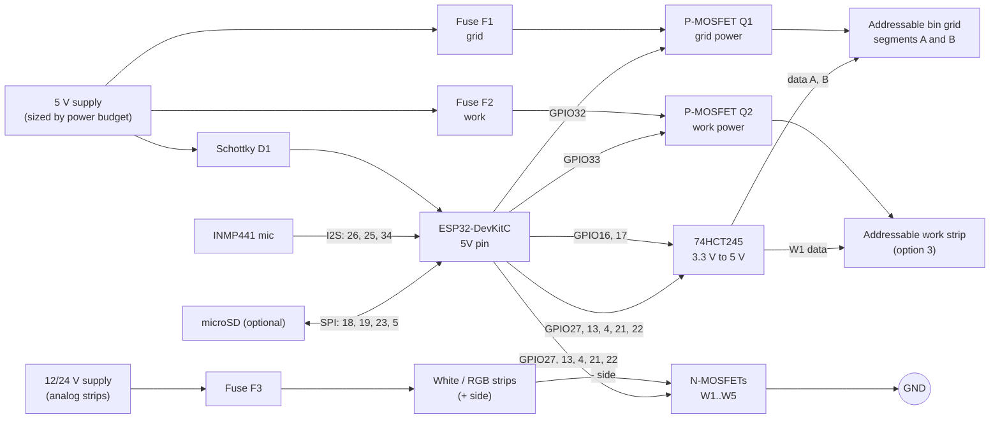

# Smart Bins hardware reference

This is the reference circuit for Smart Bins on an **ESP32-DevKitC** (ESP32-WROOM-32, 8 or 16 MB flash). It covers the addressable bin grid, the work lights, the microphone and the optional microSD card. Every block can be built on perfboard; a PCB can come later.

The default pin map lives in [`lib/Board/src/PinMap.h`](../../lib/Board/src/PinMap.h). The firmware checks it at compile time and prints it at boot. From Task 14 on, pins and channel modes can be changed from the web UI.

> **Safety first:** LED strips draw many amps. Fuse every supply branch, use wire rated for the current, and never power a full grid through the DevKitC's USB port.

---

## 1. Block diagram



All grounds (5 V supply, 12/24 V supply, ESP32) are joined at one point near the 5 V supply.

---

## 2. Pin map

| Priority | Function | GPIO | Direction | Circuit |
|---|---|---|---|---|
| 1 | Grid data A | 16 | out | 74HCT245 → 330 Ω → grid segment A |
| 1 | Grid data B | 17 | out | 74HCT245 → 330 Ω → grid segment B |
| 1 | Grid power enable | 32 | out | Q1 high-side switch (section 4) |
| 2 | Work channel W1 | 27 | out | N-MOSFET **and** 74HCT245 (universal) |
| 2 | Work channel W2 | 13 | out | universal |
| 2 | Work channel W3 | 4 | out | universal |
| 2 | Work addressable power enable | 33 | out | Q2 high-side switch |
| 3 | Auxiliary channel W4 | 21 | out | universal |
| 3 | Auxiliary channel W5 | 22 | out | universal |
| 3 | Microphone I2S SCK / WS / SD | 26 / 25 / 34 | out / out / in | INMP441 |
| 3 | Analog microphone (instead of I2S) | 35 | in (ADC1) | MAX9814 |
| – | microSD SCK / MISO / MOSI / CS | 18 / 19 / 23 / 5 | SPI | optional, photos on 4 MB boards |
| – | Button (clear highlight, factory reset) | 0 | in | on-board BOOT button |
| – | Status LED | 2 | out | on-board LED |
| – | Spare | 14 (W6), 36, 39 (input-only), 15 | | |

Pins to avoid: **GPIO6–11** (internal flash), **GPIO1/3** (USB serial), **GPIO12** (sets flash voltage at boot; pulled high, the board won't start), **GPIO34–39** as outputs (input-only). The firmware's pin validator rejects all of these.

### Work-light options

Each work channel is wired to both an N-MOSFET (for plain strips) and a 74HCT245 input (for addressable strips). Which connector a strip uses decides its type, and the channel's mode is a setting, so one board covers every option:

| Option | W1 | W2 | W3 | W4, W5 |
|---|---|---|---|---|
| 1. Three dimmable white strips | white | white | white | extra white |
| 2. One analog RGB strip | R | G | B | extra white |
| 3. One addressable RGB strip | addressable data | spare white | spare white | extra white |

A second analog RGB strip uses W4, W5 and GPIO14 (W6). GPIO14 toggles briefly during boot; the gate pull-down mostly hides it, which is why it is last in line.

---

## 3. Level shifter (U1, 74HCT245)

The ESP32 outputs 3.3 V; WS2812/SK6812 need at least 0.7 × VDD = 3.5 V on data at 5 V. A 74**HCT**245 powered from 5 V accepts 3.3 V as a logic high and outputs clean 5 V edges. (Use HCT, not HC: HC needs 3.5 V at its inputs.)

```
                 74HCT245 (U1)
               +-------------+
   +5V --------| 20 VCC      |
   GND --------| 10 GND      |
   +5V --------|  1 DIR      |   DIR high: A -> B
   GND --------| 19 /OE      |   always enabled
               |             |
 GPIO16 -------|  2 A1  B1 18|---[330R]---> grid segment A DIN
 GPIO17 -------|  3 A2  B2 17|---[330R]---> grid segment B DIN
 GPIO27 (W1) --|  4 A3  B3 16|---[330R]---> W1 addressable connector
 GPIO13 (W2) --|  5 A4  B4 15|---[330R]---> W2 addressable connector
 GPIO4  (W3) --|  6 A5  B5 14|---[330R]---> W3 addressable connector
 GPIO21 (W4) --|  7 A6  B6 13|---[330R]---> W4 addressable connector
 GPIO22 (W5) --|  8 A7  B7 12|---[330R]---> W5 addressable connector
   GND --------|  9 A8  B8 11|--- n.c.
               +-------------+
   100 nF ceramic from pin 20 to pin 10, as close to the chip as possible
```

- Put the 330 Ω resistors at the shifter end of the data wire. They damp ringing on long cables and protect the first LED.
- Keep data wires short (under ~1 m) and run a ground wire alongside each one. For longer runs, place the shifter near the strip or use a twisted pair (data + GND).
- Unused A inputs must not float: A8 is tied to GND. Unused work channels are driven low by the firmware.

---

## 4. Power switches for addressable strips (Q1 grid, Q2 work strip)

A high-side P-MOSFET disconnects the strip's +5 V. That removes the idle current of every LED (about 1 mA each, even when dark), lets the firmware cut power on a fault, and keeps strips dark while the ESP32 boots.

```
   +5V (after fuse F1) ---+--------------+
                          |              |
                       R1 10k            S
                          |              |
                          +-----------G  Q1  AO4407A (P-MOSFET)
                          |              |
                          |              D
                          |              |
                          |              +----> +5V switched to grid strips
                          |                     (1000 uF / 10 V at each strip input)
                          C
   GPIO32 --[1k]--+---B   Q3  BC547 / 2N3904 (NPN)
                  |       E
                [10k]     |
                  |       |
   GND -----------+-------+
```

- GPIO32 high → Q3 on → Q1 gate pulled to 0 V → grid powered.
- GPIO32 low, floating or ESP32 in reset → Q3 off → R1 holds the gate at +5 V → grid off. That is the safe default.
- **AO4407A** (SO-8, −30 V, 12 A, about 20 mΩ at −4.5 V gate drive) handles up to about 6 A comfortably. Mount it on an SO-8 adapter with generous copper; for a bigger grid, put two in parallel or split the grid across Q1 per segment. Avoid IRF9540 and IRF4905-class parts: they are rated for −10 V gate drive and run hot at −5 V.
- Q2 (work strip, GPIO33) is the same circuit. If you never use an addressable work strip, leave it out.
- **Phantom power:** while a strip is switched off, its data line must stay low, or the LED's data input will power the strip through its protection diode. The firmware holds every data line low while its power switch is off.

---

## 5. Analog work-light channels (N-MOSFET, W1–W5)

Plain white and RGB strips (5, 12 or 24 V) are dimmed by switching their minus side with a logic-level N-MOSFET. The ESP32's LEDC hardware PWM runs at about 19.5 kHz with 12-bit resolution, so there is no visible flicker (even on camera) and no audible whine.

```
   +12/24 V (after fuse F3) ---------------> strip +
                                             strip - (or R / G / B)
                                                 |
                                                 D
   GPIO27 (W1) --[100R]--+------------------ G  Q4  N-MOSFET
                         |                       S
                       [10k]                     |
                         |                       |
                        GND ---------------------+---- GND (common)
```

- **AO3400A** (SOT-23, 30 V, 5.7 A, specified at 2.5 V gate drive) for up to about 3 A per channel. **IRLB8721** (TO-220) for more current. Both switch fully at 3.3 V gate drive; IRLZ44N is only partly on at 3.3 V and gets warm.
- 100 Ω limits gate current spikes; 10 kΩ keeps the MOSFET off while the ESP32 boots or is unplugged.
- No flyback diode is needed for LED strips (resistive load). Add a 1000 µF capacitor across the 12/24 V supply at the board.
- For an RGB strip, wire its common anode to +V and R, G and B to W1, W2 and W3.
- The same GPIO also drives the 74HCT245 input. In PWM mode the addressable connector just sees a PWM signal; nothing is connected there, so it does no harm.

---

## 6. ESP32 power

```
   +5V supply --[fuse 1A]--|>|-- DevKitC "5V" pin
                          D1 SS34 Schottky
   GND ---------------------- DevKitC "GND" pin
```

- D1 stops the external 5 V from back-feeding the computer's USB port while you are connected for flashing (many DevKitC clones have no diode of their own).
- The DevKitC's on-board regulator makes 3.3 V for the ESP32, the microphone and the microSD card. Don't power anything else from it.

---

## 7. Microphone (optional)

**INMP441 (I2S, recommended)**

| INMP441 | ESP32 |
|---|---|
| VDD | 3V3 |
| GND | GND |
| L/R | GND (left channel) |
| SCK | GPIO26 |
| WS | GPIO25 |
| SD | GPIO34 |

Keep the wires under 20 cm. Digital I2S is immune to the ESP32 ADC's noise, which is why it is preferred.

**MAX9814 (analog, alternative):** VDD to 3V3, OUT to GPIO35, GAIN floating (60 dB) or to GND (50 dB). Use one microphone type or the other, not both.

---

## 8. microSD card (optional)

Needed only for large photo collections, or for photos on a 4 MB board. Use a 3.3 V microSD module (no on-board 5 V regulator) wired to SCK GPIO18, MISO GPIO19, MOSI GPIO23, CS GPIO5, VCC 3V3, GND.

---

## 9. Grid wiring

- **Segments:** the grid can run as one segment (data A only) or two (A and B, e.g. upper and lower half). Two segments halve the refresh time and keep half the grid working if one strip fails.
- **Inside a segment**, rows are chained in a snake (serpentine): row 1 left to right, row 2 right to left, and so on. The firmware's mapper also supports progressive rows and any start corner, set in the configuration (Task 3).
- **Power injection:** feed +5 V and GND into each row (or every ~1 m of strip) from the switched grid supply. Connect data only at the start of each segment.
- **Capacitors:** 1000 µF / 10 V across +5 V and GND at each segment's start.
- **LEDs per bin:** 1, 2 or 3, the same for the whole grid (set in the configuration).

---

## 10. Power budget

Run the calculator with your grid size:

```sh
python3 tools/power_budget.py --cols 10 --rows 6 --leds-per-bin 2 --work-leds 60
```

```
Grid:              10 x 6 bins x 2 LED = 120 LEDs
Addressable work:  60 LEDs
All white, 100 %:  10.8 A  (theoretical maximum, never needed)
All dark:          180 mA  (cut to 0 by the power switches)
Firmware limit:    6.0 A
5 V supply:        >= 9 A  (45 W)
Main 5 V wiring:   18 AWG (0.75 mm2), inject power every ~1 m or every row
```

Rules of thumb:
- One WS2812B at full white draws about 60 mA; SK6812 RGBW up to 80 mA with white on.
- The firmware limits the total current (FastLED power limiting, Task 4), so the supply only has to cover that limit plus about 0.5 A for the ESP32, with 20 % headroom.
- Fuses: F1 (grid) and F2 (work strip) at about 1.2 × the firmware limit, slow-blow or automotive blade fuses. F3 (analog strips) from the strips' W/m rating.

---

## 11. Bill of materials

| Ref | Part | Qty | Notes |
|---|---|---|---|
| – | ESP32-DevKitC (WROOM-32, 8/16 MB) | 1 | |
| U1 | 74HCT245 (DIP-20 or SOIC-20) | 1 | must be HCT |
| Q1, Q2 | AO4407A P-MOSFET (SO-8) | 1–2 | Q2 only for an addressable work strip |
| Q3, Q3' | BC547 / 2N3904 NPN | 1–2 | gate drivers for Q1, Q2 |
| Q4–Q8 | AO3400A (or IRLB8721) N-MOSFET | 3–5 | one per analog work channel |
| D1 | SS34 Schottky | 1 | ESP32 supply |
| R | 330 Ω | 7 | data line series |
| R | 1 kΩ | 2 | NPN base |
| R | 10 kΩ | 9 | gate pull-ups / pull-downs, base pull-downs |
| R | 100 Ω | 5 | N-MOSFET gate |
| C | 100 nF ceramic | 1 | U1 decoupling |
| C | 1000 µF / 10 V electrolytic | 1 per segment + 1 | strip inputs |
| C | 1000 µF / 35 V electrolytic | 1 | 12/24 V input |
| F1–F3 | fuses + holders | 3 | sized from the power budget |
| – | 5 V supply | 1 | from the power budget |
| – | 12/24 V supply | 0–1 | only for analog work strips |
| – | INMP441 module | 0–1 | music-reactive effects |
| – | microSD module (3.3 V) | 0–1 | optional |
| – | JST-SM 3-pin / screw terminals | as needed | strip connectors |

---

## 12. First power-up checklist

1. Before connecting any strip, power the board from the 5 V supply and check: 5 V at the DevKitC, 3.3 V at its 3V3 pin, 5 V at U1 pin 20.
2. Flash the firmware. With nothing connected, the switched +5 V outputs of Q1 and Q2 must read 0 V.
3. Connect one short strip (8–10 LEDs) to segment A. Do the LED tests from Task 4 at low brightness before connecting the full grid.
4. Check that no MOSFET or wire gets warm at the firmware's current limit.
