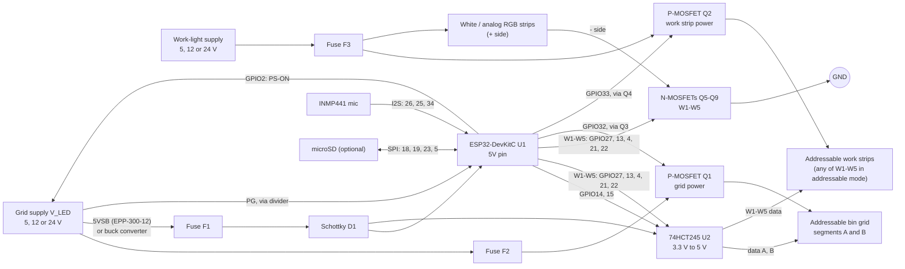
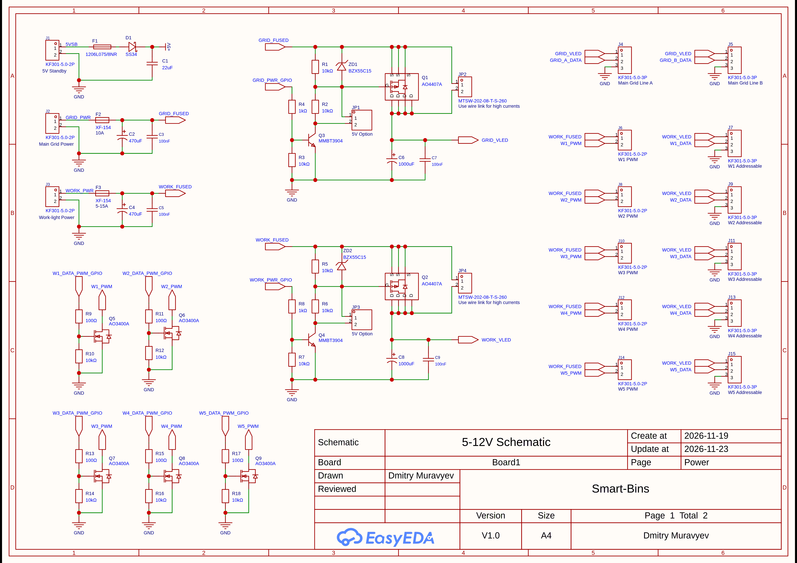
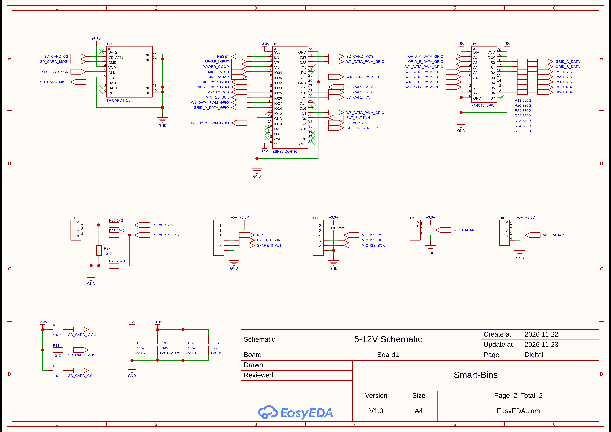

# Smart Bins hardware reference

This is the reference circuit for Smart Bins on an **ESP32-DevKitC** with an **ESP32-WROOM-32E-N16R2** or **-32UE-N16R2** module (16 MB flash, 2 MB PSRAM; the UE has an antenna connector). Boards with a plain WROOM-32 (4, 8 or 16 MB flash, no PSRAM) run the same circuit with the non-PSRAM firmware builds. It covers the addressable bin grid, the work lights, the microphone and the optional microSD card. Every block can be built on perfboard, and section 14 is a PCB with all of them. The part numbers in this guide (U2, Q1, R19 and so on) are the ones in that PCB's schematic.

The grid's LED supply can be **5, 12 or 24 V**, depending on the strips (section 3). The reference build uses 12 V WS2815 or WS2811 strips, 10 × 6 bins with 2 pixels per bin, powered by a **Mean Well EPP-300-12**. Any supply of the right voltage works; the EPP-300-12 adds a standby 5 V output and remote on/off, which the circuit uses when they are there (section 7).

The default pin map lives in [`lib/Board/src/boards/Esp32Pins.h`](../../../lib/Board/src/boards/Esp32Pins.h). The firmware checks it at compile time and prints it at boot. From Task 14 on, pins and channel modes can be changed from the web UI.

### Flash mode

The firmware reads the module's flash at **80 MHz in QIO mode** (`board_build.f_flash` and `board_build.flash_mode` in `platformio.ini`), about four times as fast as the 40 MHz DIO most ESP32 boards default to. Every Espressif ESP32-WROOM-32 (D/U/E/UE) and WROVER module supports it. A board that doesn't is one with a bare ESP32 chip and a third-party flash chip that lacks quad mode, or one that uses GPIO9/10 (the flash's two extra data lines) for something else. The symptom is a boot loop or flash read errors right after flashing. For such a board set `board_build.flash_mode = dio`, and if it still fails, `board_build.f_flash = 40000000L`. The bootloader applies both, so flash over USB after changing them; an update over the network keeps the old bootloader. The boot report shows what is in use (`Flash: … 80 MHz, QIO`).

> **Safety first:** LED strips draw many amps. Fuse every supply branch, use wire rated for the current, and never power a grid through the DevKitC's USB port.

---

## 1. Block diagram



All grounds (grid supply, work-light supply, ESP32) are joined at one point near the supplies. PS-ON and PG exist only on supplies with remote control, such as the EPP-300-12; with any other supply the ESP32 gets its 5 V from a buck converter (section 7). The work-light supply can be the same unit as the grid supply when the voltages match.

---

## 2. Pin map

| Priority | Function | GPIO | Direction | Circuit |
|---|---|---|---|---|
| 1 | Grid data A | 14 | out | 74HCT245 → 330 Ω → grid segment A |
| 1 | Grid data B | 15 | out | 74HCT245 → 330 Ω → grid segment B |
| 1 | Grid power enable | 32 | out | Q1 high-side switch (section 5) |
| 2 | Work channel W1 | 27 | out | N-MOSFET **and** 74HCT245 |
| 2 | Work channel W2 | 13 | out | N-MOSFET and 74HCT245 |
| 2 | Work channel W3 | 4 | out | N-MOSFET and 74HCT245 |
| 2 | Work strip power enable | 33 | out | Q2 high-side switch, for addressable work strips |
| 2 | Supply on/off (PS-ON) | 2 | out | EPP-300-12 and similar; optional (section 7) |
| 2 | Supply power good (PG) | 39 | in | via divider; optional (section 7) |
| 3 | Work channel W4 | 21 | out | N-MOSFET and 74HCT245 |
| 3 | Work channel W5 | 22 | out | N-MOSFET and 74HCT245 |
| 3 | Microphone I2S SCK / WS / SD | 26 / 25 / 34 | out / out / in | INMP441 |
| 3 | Analog microphone (instead of I2S), or motion sensor | 35 | in (ADC1) | MAX9814; LD2410C, HC-SR501, AM312 (section 8) |
| – | microSD SCK / MISO / MOSI / CS | 18 / 19 / 23 / 5 | SPI | optional |
| – | Button (clear highlight, factory reset) | 0 | in | on-board BOOT button |
| – | Status LED | 2 | out | on-board LED; set to – in Settings when PS-ON is wired to GPIO2 |
| – | Spare | 36 (input-only) | | |
| – | PSRAM (N16R2 modules) | 16, 17 | | used inside the module, not available |

Pins to avoid: **GPIO6–11** (internal flash), **GPIO1/3** (USB serial), **GPIO12** (sets flash voltage at boot; pulled high, the board won't start), **GPIO34–39** as outputs (input-only), and **GPIO16/17** on modules with PSRAM (the PSRAM build rejects them). The firmware's pin validator rejects all of these.

GPIO14 and GPIO15 put out a short burst of signals while the ESP32 boots. The grid doesn't see it as data because its power is still off then (Q1 or PS-ON), and the firmware holds both lines low from its first instructions on. GPIO2 must be low or open at boot for USB flashing to work; the PS-ON pull-down (section 7) keeps it low.

### Work-light options

Every work channel W1–W5 is wired to both an N-MOSFET (plain strips) and a 74HCT245 input (addressable strips). Each channel's mode is a setting, so the same board covers both options:

| Option | W1 | W2 | W3 | W4, W5 |
|---|---|---|---|---|
| 1. Analog RGB strip + other strips | R | G | B | addressable **or** white |
| 2. Universal channels | addressable **or** white | addressable **or** white | addressable **or** white | addressable **or** white |

**How many addressable strips at once.** The two grid lines and all five work channels can be addressable together: seven strips, each on its own RMT channel (the ESP32 has eight). The firmware divides the RMT's transmit memory among the strips actually in use, so fewer strips get more of it. Two things to know with many strips:

- With six or seven strips, most of them get the minimum of transmit memory, and each one then needs a refill interrupt every 40 µs while its frame goes out. A refill delayed by Wi-Fi or a flash write shows as a brief flicker or a cut-short frame. Fewer strips, or a single grid segment, leave more slack.
- Without PSRAM, the addressable work strips together are limited to 3,000 pixels (three full strips), so the board keeps the free memory it needs for the web server. With PSRAM (the recommended N16R2 module) each of the five can have the full 1,000.

---

## 3. Supported LED strips

| Chipset | Strip voltage | Pixel | Notes |
|---|---|---|---|
| WS2812 / WS2812B | 5 V | 1 LED | most common; needs power injection every ~1 m |
| SK6812 (RGB / RGBW) | 5 V | 1 LED | RGBW adds a white die |
| WS2815 | 12 V | 1 LED | backup data line: if one pixel dies the rest keep working |
| WS2811 (12 V strip) | 12 V | 1 IC driving 3 LEDs | a pixel is a segment, often 5–10 cm long |
| WS2811 (24 V strip) | 24 V | 1 IC driving 6 LEDs | longer segments |

- All of them want a **5 V data signal**, whatever the strip voltage, so the same level shifter serves every type.
- **WS2815:** each pixel has a data input (DI) and a backup input (BI). At the start of each segment connect **BI to GND** and DI to the level shifter.
- **WS2811 strips:** check that the pixel length fits your bin pitch. With 2 pixels per bin, a 10 cm segment needs bins at least 20 cm wide; otherwise use 1 pixel per bin, or pick a strip with shorter segments.
- 12/24 V strips draw much less current for the same light than 5 V strips, and need far less power injection. That's why they're recommended for larger grids.
- The chipset and color order are settings in the firmware (Task 3). The strip voltage is not: the firmware only sends data and switches power, so it works the same at 5, 12 or 24 V.

---

## 4. Level shifter (U2, 74HCT245)

The ESP32 outputs 3.3 V; the strips need at least about 3.5 V on data. A 74**HCT**245 powered from 5 V accepts 3.3 V as a logic high and outputs clean 5 V edges. (Use HCT, not HC: HC needs 3.5 V at its inputs.)

```
                 74HCT245 (U2)
               +-------------+
   +5V --------| 20 VCC      |
   GND --------| 10 GND      |
   +5V --------|  1 DIR      |   DIR high: A -> B
   GND --------| 19 /OE      |   always enabled
               |             |
 GPIO14 -------|  2 A1  B1 18|--[R19 330R]--> grid segment A DIN
 GPIO15 -------|  3 A2  B2 17|--[R20 330R]--> grid segment B DIN
 GPIO27 (W1) --|  4 A3  B3 16|--[R21 330R]--> W1 addressable connector
 GPIO13 (W2) --|  5 A4  B4 15|--[R22 330R]--> W2 addressable connector
 GPIO4  (W3) --|  6 A5  B5 14|--[R23 330R]--> W3 addressable connector
 GPIO21 (W4) --|  7 A6  B6 13|--[R24 330R]--> W4 addressable connector
 GPIO22 (W5) --|  8 A7  B7 12|--[R25 330R]--> W5 addressable connector
   GND --------|  9 A8  B8 11|--- n.c.
               +-------------+
   C10 100 nF ceramic from pin 20 to pin 10, as close to the chip as possible
```

- U2 runs from 5 V: the DevKitC's 5V pin (USB or buck converter), never from 12/24 V.
- Put the 330 Ω resistors at the shifter end of the data wire. They damp ringing on long cables and protect the first pixel.
- Keep data wires short (under ~1 m) and run a ground wire alongside each one. For longer runs, place the shifter near the strip or use a twisted pair (data + GND).
- The unused input (A8) is tied to GND so it doesn't float.

### Breadboard prototype

For a breadboard test any of these works:
- **A 74HCT245 or 74HCT125 in DIP package.** It plugs straight into the breadboard and is the most reliable choice.
- **Two-transistor non-inverting shifter** (e.g. 2 × BC547 or 2N3904, or 2N7002 + BC557). A **single** transistor stage inverts the signal. The ESP32 can invert an output pin in hardware, so the firmware can offer an "invert data" option for that case (Task 4), but it's easy to forget, so a non-inverting stage is preferred.
- **BSS138 "bidirectional" modules:** their 10 kΩ pull-ups give slow rising edges. They often work at 800 kHz over short wires, but can flicker. Fine for a quick test, not for the final build.
- **No shifter at all** sometimes works with 5 V strips over a few centimetres of wire, but isn't reliable. Don't count on it.

---

## 5. Power switches for addressable strips (Q1 grid, Q2 work strips)

A high-side P-MOSFET disconnects the strip's V_LED. That removes the idle current of every pixel (about 1 mA each, even when dark), lets the firmware cut power on a fault, and keeps strips dark while the ESP32 boots.

```
   V_LED (after fuse F2) ---+-------+--------+
                            |       |        |
                            |     ZD1 15V    |
                         R1 10k  (cathode    |
                            |      to S)     S
                            |       |        |
                            +-------+------G Q1  AO4407A (P-MOSFET)
                            |                |
                            R2               D
                     (see table)             |
                            |                +----> V_LED switched, to grid strips
                            C                       (1000 uF capacitor at each strip input)
   GPIO32 -[R4 1k]-+-----B  Q3  NPN: BC547 / 2N3904, or BC847B / MMBT3904 (SOT-23)
                   |        E
               [R3 10k]     |
                   |        |
   GND ------------+--------+
```

| V_LED | R2 | Gate drive (V_GS) | Q1 |
|---|---|---|---|
| 5 V | 0 Ω (on the PCB: close JP1, JP3 for Q2) | −5 V | AO4407A |
| 12 V | 10 kΩ | −6 V | AO4407A |
| 24 V | 27 kΩ | −6.5 V | AOD4185 (−40 V) or another P-MOSFET rated ≥ 40 V |

- GPIO32 high → Q3 on → R1/R2 divide V_LED and pull the gate below the source → grid powered.
- GPIO32 low, floating or ESP32 in reset → Q3 off → R1 holds the gate at the source → grid off. That's the safe default.
- R2 keeps V_GS inside the MOSFET's ±20 V limit at 12/24 V. ZD1 (15 V zener between gate and source, in parallel with R1, cathode to source) clamps voltage spikes on the gate; it never conducts in normal operation. It does not replace R2: always fit the R2 from the table.
- **AO4407A** (SO-8, −30 V, 12 A, about 20 mΩ at −4.5 V gate drive) handles up to about 6 A comfortably. Mount it on an SO-8 adapter with generous copper. At 12/24 V the currents are small (the reference grid draws at most about 3 A), so it runs cool. Avoid IRF9540 and IRF4905-class parts at 5 V: they need −10 V gate drive.
- **Q3** only switches the 0.5–2.5 mA through R1/R2, and the 1 kΩ from a 3.3 V pin gives it about 2.6 mA of base current, so any small NPN rated for V_LED works: BC547 or 2N3904 (TO-92), or **BC847B** or **MMBT3904** (SOT-23, rated 45 V and 40 V). The letter after BC847 is only the gain group (A, B, C); any of them works and B is the common one. Mind the package: a W suffix (BC847BW) is the smaller SOT-323. In SOT-23 both have pin 1 = base, 2 = emitter, 3 = collector.
- Q2 (addressable work strips, GPIO33) is the same circuit, with **Q4** as its driver, R5–R8 in place of R1–R4, and ZD2. Leave it out if no work strip is addressable.
- **Phantom power:** while a strip is switched off, its data line must stay low, or the pixel's data input will power the strip through its protection diode. The firmware holds every data line low while its power switch is off.
- **Smooth transitions:** the firmware switches the power on before a fade-in starts and off only after a fade-out has finished, so normal on/off is always smooth. Only a fault or power loss cuts it instantly.

---

## 6. Plain work-light channels (N-MOSFET, W1–W5)

Plain white and analog RGB strips (5, 12 or 24 V) are dimmed by switching their minus side with a logic-level N-MOSFET. The ESP32's LEDC hardware PWM runs at about 19.5 kHz with 12-bit resolution, so there is no visible flicker (even on camera) and no audible whine. Fades are gamma-corrected so they look even to the eye.

```
   V_STRIP (after fuse F3) ----------------> strip +
                                             strip - (or R / G / B)
                                                 |
                                                 D
   GPIO27 (W1) -[R9 100R]-+----------------- G  Q5  N-MOSFET
                          |                      S
                      [R10 10k]                  |
                          |                      |
                         GND --------------------+---- GND (common)
```

- **AO3400A** (SOT-23, 30 V, 5.7 A, specified at 2.5 V gate drive) for up to about 3 A per channel. **IRLB8721** (TO-220) for more current. Both switch fully at 3.3 V gate drive; IRLZ44N is only partly on at 3.3 V and gets warm.
- 100 Ω limits gate current spikes; 10 kΩ keeps the MOSFET off while the ESP32 boots or is unplugged. W2–W5 are the same with Q6–Q9 and R11–R18.
- No flyback diode is needed for LED strips (resistive load). Add a 470–1000 µF capacitor across V_STRIP at the board (C4 on the PCB).
- For an analog RGB strip (option 1), wire its common anode to V_STRIP and R, G and B to W1, W2 and W3.
- The same GPIO also drives the 74HCT245. In PWM mode the addressable connector just sees a PWM signal; nothing is connected there, so it does no harm.

---

## 7. Supply and ESP32 power

### Option A: Mean Well EPP-300-12 (reference build)

Besides its 12 V main output, the EPP-300-12 has a **5 V standby output (5VSB)** that stays on while the main output is off, a **PS-ON** input that turns the main output on and off, and a **PG** (power good) output. That lets the ESP32 run from 5VSB and switch the whole 12 V side off when every light is off, with no buck converter.

```
   EPP-300-12 CN951 (Hirose DF11, 4 pins)
     1 5VSB ---[F1]---|>|------------------- DevKitC "5V" pin, U2 VCC
                      D1 SS34
     2, 4 DC COM ----------------------------- GND (common)
     3 PS-ON ----+--[R26 1k]---------------- GPIO2
                 |
            [R27 10k]  PS-ON pull-down: supply stays off while the ESP32 boots
                 |
                GND

   EPP-300-12 CN100 (Hirose DF11, 4 pins)
     4 PG ----[R28 10k]--+------------------ GPIO39 (input-only)
                         |
                    [R29 20k]  divider: 5 V TTL -> 3.3 V
                         |
                        GND
     3 DC COM ----------------------------- GND
     1 -S, 2 +S          not connected (remote sense; the supply uses its own terminals when open)

   Main output: CN3 +V, CN2 -V (M3.5 screws) --> F2, F3 --> grid, work strips
   Fan connector CN952 (JST XH, 2 pins): +12 V AUX, 0.5 A, for an enclosure fan if needed
```

- **5VSB** gives 0.6 A without a fan. The ESP32 with Wi-Fi (about 250 mA peaks), U2, the microphone and a microSD card stay below about 0.45 A.
- **PS-ON** turns the main output on above 2 V and off below 0.5 V. The ESP32 drives it directly from GPIO2 (on DevKitC clones that have an on-board LED on GPIO2, the LED lights while the supply is on; set the status LED to – in Settings so the firmware doesn't also use the pin). The datasheet doesn't say whether PS-ON has an internal pull-up. **Before connecting it**, measure PS-ON against DC COM with the supply on and nothing connected: if it reads above 0.5 V, there is a pull-up, and the 10 kΩ pull-down must be small enough to hold it below 0.5 V (start with 2.2 kΩ and measure again).
- **PG** goes high 10–500 ms after the main output is up, and low at least 1 ms before it drops below 90 %. The firmware waits for PG before sending LED data, and treats PG going low as a power failure. If PG reads 0 V with the main output on and the divider connected, it's an open-collector output: replace the 20 kΩ with a 10 kΩ pull-up from GPIO39 to 3V3.
- With PS-ON in use, the P-MOSFET switches Q1 and Q2 (section 5) are optional: turning the supply off already removes the pixels' idle current. Keep them if the grid and the work strips should switch independently (without them, the grid idles at about 120 mA while only a work light is on).
- **Cooling:** without a fan the EPP-300-12 delivers 200 W (16.7 A), far more than the reference grid needs (about 36 W at full white), so no fan is required. The AUX output can drive a small 12 V fan for the enclosure.
- **Mains:** the EPP-300 is an open-frame supply with exposed mains. Mount it in a closed enclosure and feed it through an IEC inlet with a fuse and a switch. AC goes in on CN1 (JST VH): pin 1 N, pin 3 L, pin 5 protective earth (FG), which the datasheet requires to be connected. Also earth the mounting holes marked for grounding if the enclosure is metal.
- **Fuses:** the main output can deliver 25 A into a short, so fuses F2 and F3 are essential.
- **On the PCB** PS-ON, GND and PG come out on H1, with R26–R29 on the board; 5VSB and its GND go to J1.
- **Breadboard shortcut:** without the firmware driving PS-ON (its pin not set), wire PS-ON to 5VSB to keep the main output on.
- **Firmware:** set the pins in Settings, Pins: **LED supply on/off (PS-ON)** to GPIO2 (and the status LED to –), **LED supply power good (PG)** to GPIO39. The main output then goes on as soon as any light needs power and off once every light has been dark for about 2.5 seconds; the grid and work-strip switches close, and LED data goes out, only once PG is high (500 ms after PS-ON without PG). PG dropping while the output is on is logged as a supply fault; a PG that doesn't come up within 2 s is logged too, and the lights go on anyway.

### Option B: any other supply

```
   V_LED = 5 V:      +5V supply --[F1 1A]----|>|-- DevKitC "5V" pin, U2 VCC
   V_LED = 12/24 V:  V_LED --[F1 1A]---- buck converter (set to 5.0 V, >= 1 A) --|>|-- DevKitC "5V" pin, U2 VCC
                                                                               D1 SS34 Schottky
   GND ----------------------------------------------------------------------- DevKitC "GND" pin
```

- Any small buck module works (MP1584, LM2596 or a fixed 5 V type). Set it to 5.0 V **before** connecting the ESP32.
- GPIO2 (or just the status LED) and GPIO39 stay unconnected; Q1 and Q2 (section 5) do the power switching.

### Both options

- D1 stops the supply from back-feeding the computer's USB port while you are connected for flashing (many DevKitC clones have no diode of their own).
- The DevKitC's on-board regulator makes 3.3 V for the ESP32, the microphone and the microSD card. Don't power anything else from it.

---

## 8. Microphone and motion sensor (optional)

**INMP441 (I2S, recommended)**

| INMP441 | ESP32 |
|---|---|
| VDD | 3V3 |
| GND | GND |
| L/R | GND (left channel) |
| SCK | GPIO26 |
| WS | GPIO25 |
| SD | GPIO34 |

On the PCB it plugs into H3. Keep the wires under 20 cm. Digital I2S is immune to the ESP32 ADC's noise, which is why it is preferred.

**MAX9814 (analog, alternative):** VDD to 3V3, OUT to GPIO35, GAIN floating (60 dB) or to GND (50 dB). Use one microphone type or the other, not both.

**Motion sensor (optional, instead of the analog microphone):** a master switch over the lights: they fade to dark when nobody has been at the bench for a while and come back as they were when someone stays (Settings, Motion sensor; user guide, Motion sensor). Its digital output goes to GPIO35, the analog microphone's pin, so the two can't be used together; the I2S microphone can.

| Module | Supply | Notes |
|---|---|---|
| **LD2410C** (24 GHz radar, recommended) | 5 V | OUT is 3.3 V, straight to GPIO35. Also senses someone sitting still, which a PIR doesn't. Limit its range in the HLKRadarTool phone app (the gates past your chair off) so people elsewhere in the room don't count. |
| HC-SR501 (PIR) | 5–20 V (the 12 V rail works) | OUT is 3.3 V. Set the jumper to repeat trigger (H) and the time pot to the minimum (about 3 s); turn the sensitivity pot down to shorten its range. Its output goes low between movements, so give the lights a longer off delay. |
| AM312 (small PIR) | 2.7–12 V | OUT is 3.3 V; fixed range of a few meters and a 2 s hold. |

On the PCB, a 5 V sensor (LD2410C, HC-SR501) or the MAX9814 goes on H5, which has both +5V and +3.3V; a 3.3 V sensor such as the AM312 can use H4. Both carry GPIO35, so only one of them is used.

Point the sensor at the chair rather than the room. The lights come on only once the output has stayed on for the whole on delay (5s by default), which a person walking past doesn't keep up.

---

## 9. microSD card (optional)

Used for photos: with a card, photos are stored at 800 px instead of 640 px, and there is room for thousands of them. Use a 3.3 V microSD module (no on-board 5 V regulator) wired to SCK GPIO18, MISO GPIO19, MOSI GPIO23, CS GPIO5, VCC 3V3, GND. The PCB has a microSD socket (TF1) instead, with 10 kΩ pull-ups on CS, MOSI and MISO (R30–R32).

Use an **8–32 GB microSDHC** card from a known brand, formatted FAT32. Cards of 64 GB and up come formatted exFAT, which the ESP32's file system doesn't read. Capacity hardly matters: an 800 px photo is about 100 KB, so even 8 GB holds tens of thousands.

---

## 10. Grid wiring

- **Segments:** the grid can run as one segment (data A only) or two (A and B, e.g. upper and lower half). Two segments halve the refresh time and keep half the grid working if a strip fails.
- **Inside a segment**, rows are chained in a snake (serpentine): row 1 left to right, row 2 right to left, and so on. The firmware's mapper also supports progressive rows and any start corner, set in the configuration (Task 3).
- **Pixels per bin:** 1, 2 or 3 (reference build: 2). Per-row or per-column exceptions may come in Task 4.
- **Power injection:** feed V_LED and GND into each row, or every ~1 m of 5 V strip (12/24 V strips need it much less often). Connect data only at the start of each segment.
- **Capacitors:** 1000 µF across V_LED and GND at each segment's start, rated at least 10 V for 5 V strips, 25 V for 12 V and 35 V for 24 V.

---

## 11. Power budget

Run the calculator with your grid size and chipset:

```sh
python3 tools/power_budget.py --cols 10 --rows 6 --pixels-per-bin 2 --chip ws2815
```

```
Chipset:           ws2815 (12 V, ~25 mA per pixel at full white)
Grid:              10 x 6 bins x 2 pixels = 120 pixels
Addressable work:  0 pixels
All white, 100 %:  3.0 A  (36 W, theoretical maximum)
All dark:          120 mA  (cut to 0 by the power switches)
Firmware limit:    1.0 A  (12 W)
LED supply:        12 V, >= 2 A  (24 W), includes the ESP32
ESP32 supply:      5VSB, or a buck converter 12 V -> 5 V, >= 1 A
Grid fuse:         2 A slow-blow
Main LED wiring:   22 AWG (0.35 mm2), inject power every ~1 m or every row
```

Rules of thumb:
- Full white per pixel: about 60 mA at 5 V (WS2812B), about 20–25 mA at 12 V (WS2815, WS2811 segment). Real strips vary by ±20 %.
- The firmware limits the total current (estimated from the pixel data, Task 4), so the supply only has to cover that limit plus the ESP32, with 20 % headroom. A 12 V 3 A supply runs the reference grid even at full white.
- Fuses: F2 (grid) at about 1.25 × the firmware limit, slow-blow or automotive blade fuses. F3 (work strips) at about 1.25 × the addressable work strips' limits plus the plain strips' rating (W/m × length ÷ voltage). F1 (5 V for the ESP32) is 0.75–1 A.

---

## 12. Bill of materials

Quantities are for the full design; skip the optional blocks you don't need. For the PCB, [esp32-wroom-5-12v-v1.0-bom.csv](board-5-12v/esp32-wroom-5-12v-v1.0-bom.csv) lists the exact parts with their LCSC numbers.

| Ref | Part | Qty | Notes |
|---|---|---|---|
| U1 | ESP32-DevKitC with ESP32-WROOM-32E-N16R2 or -32UE-N16R2 (16 MB flash, 2 MB PSRAM) | 1 | a plain WROOM-32 (4/8/16 MB, no PSRAM) also works, with tighter memory limits |
| U2 | 74HCT245 (DIP-20 for perfboard; TSSOP-20 74HCT245PW on the PCB) | 1 | must be HCT; 7 of its 8 channels used |
| – | Buck converter, V_LED → 5 V, ≥ 1 A | 0–1 | only for 12/24 V strips without a 5 V standby output (section 7, option B) |
| Q1, Q2 | AO4407A P-MOSFET (SO-8); AOD4185 for 24 V | 0–2 | Q2 only for addressable work strips; both optional with PS-ON (section 7) |
| Q3, Q4 | NPN: BC547 / 2N3904 (TO-92) or BC847B / MMBT3904 (SOT-23) | 0–2 | gate drivers for Q1, Q2 |
| ZD1, ZD2 | 15 V zener, 0.5 W (BZX55C15) | 0–2 | gate protection for Q1, Q2 |
| Q5–Q9 | AO3400A (or IRLB8721) N-MOSFET | up to 5 | one per plain work channel |
| D1 | SS34 Schottky | 1 | ESP32 supply |
| F1 | 0.75–1 A fuse (resettable 1206L075 on the PCB) | 1 | 5 V input |
| F2, F3 | fuses + holders | 2 | grid, work strips; sized from the power budget |
| R1, R5 | 10 kΩ | 2 | gate pull-ups of Q1, Q2 |
| R2, R6 | 10 kΩ at 12 V, 27 kΩ at 24 V, 0 Ω at 5 V | 2 | gate drive of Q1, Q2 (section 5); on the PCB, JP1 / JP3 short them for 5 V |
| R3, R7 | 10 kΩ | 2 | base pull-downs of Q3, Q4 |
| R4, R8 | 1 kΩ | 2 | base resistors of Q3, Q4 |
| R9, R11, R13, R15, R17 | 100 Ω | 5 | gates of Q5–Q9 |
| R10, R12, R14, R16, R18 | 10 kΩ | 5 | gate pull-downs of Q5–Q9 |
| R19–R25 | 330 Ω | 7 | data lines (grid A, B, W1–W5) |
| R26, R27 | 1 kΩ, 10 kΩ | 1 + 1 | PS-ON series resistor and pull-down (option A) |
| R28, R29 | 10 kΩ, 20 kΩ | 1 + 1 | PG divider (option A) |
| R30–R32 | 10 kΩ | 0–3 | microSD pull-ups (PCB) |
| C1 | 22 µF ceramic | 1 | +5V |
| C10 | 100 nF ceramic | 1 | U2 decoupling |
| C2, C4 + C3, C5 | 470 µF electrolytic + 100 nF | 2 + 2 | grid and work-light supply inputs |
| C6, C8 + C7, C9 | 1000 µF electrolytic + 100 nF | 2 + 2 | after Q1, Q2; voltage rating per section 14, Capacitors |
| – | LED supply (5, 12 or 24 V) | 1 | from the power budget; reference build: Mean Well EPP-300-12 |
| – | Hirose DF11-4DS housing + DF11 crimp terminals (DF11-2428SC for 24–28 AWG wire) | 2 + 8 | EPP-300: CN951 (5VSB, PS-ON) and CN100 (PG) |
| – | JST VHR-5N housing + SVH-21T-P1.1 terminals | 1 + 3 | EPP-300 AC input CN1 |
| – | M3.5 ring or fork terminals | 4+ | EPP-300 main output screws |
| – | IEC C14 inlet with fuse holder and switch, mains cable | 1 | for any open-frame mains supply |
| – | Enclosure | 1 | closed; mains parts must not be touchable |
| – | Plain-strip supply | 0–1 | only if its voltage differs from V_LED |
| – | INMP441 module | 0–1 | music-reactive effects |
| – | microSD module (3.3 V) + 8–32 GB microSDHC card | 0–1 | optional; FAT32 |
| – | JST-SM 3-pin / screw terminals | as needed | strip connectors |

---

## 13. First power-up checklist

1. With nothing connected, set the buck converter (if used) to 5.0 V. With the EPP-300-12, check 5VSB (5.0 V) and measure PS-ON and PG as described in section 7.
2. Power the board from the LED supply and check: 5 V at the DevKitC's 5V pin, 3.3 V at its 3V3 pin, 5 V at U2 pin 20.
3. Flash the firmware. With nothing connected, the switched outputs of Q1 and Q2 must read 0 V.
4. Connect one short strip (8–10 pixels) to segment A. Do the LED tests from Task 4 at low brightness before connecting the full grid.
5. Check that no MOSFET or wire gets warm at the firmware's current limit.

---

## 14. Universal board, 5/12 V

A PCB that covers every option in this guide, even when it is fully populated: any mix of addressable, white and analog RGB work strips at 5 or 12 V, with or without PS-ON, one supply or two. It is not rated for 24 V strips: those need other parts (section 5) and would get a board of their own. Which strip a channel drives is only a setting in the firmware, so changing strip types later means plugging the strip into another connector, not changing parts. The part and net names below are the schematic's.

### Schematic

The schematic is published as a preview; the PCB layout is still in progress. The files are in [`board-5-12v/`](board-5-12v/); their names carry the board, its voltage range and the schematic revision (v1.0), so a later revision gets new files next to these:

| File | Contents |
|---|---|
| [esp32-wroom-5-12v-v1.0-schematic.pdf](board-5-12v/esp32-wroom-5-12v-v1.0-schematic.pdf) | both pages: 1 Power, 2 Digital |
| [esp32-wroom-5-12v-v1.0-schematic-1-power.png](board-5-12v/esp32-wroom-5-12v-v1.0-schematic-1-power.png), [esp32-wroom-5-12v-v1.0-schematic-2-digital.png](board-5-12v/esp32-wroom-5-12v-v1.0-schematic-2-digital.png) | the same pages as images |
| [esp32-wroom-5-12v-v1.0-bom.csv](board-5-12v/esp32-wroom-5-12v-v1.0-bom.csv) | bill of materials with LCSC part numbers |
| [esp32-wroom-5-12v-v1.0-easyeda-pro.epro2](board-5-12v/esp32-wroom-5-12v-v1.0-easyeda-pro.epro2) | the EasyEDA Pro project (opens in EasyEDA Pro, free) |

[](board-5-12v/esp32-wroom-5-12v-v1.0-schematic-1-power.png)

[](board-5-12v/esp32-wroom-5-12v-v1.0-schematic-2-digital.png)

### Power input and switches

Three 2-position screw terminals bring in the power, each with its own GND. Grid and work power can come from the same supply (wire both J2 and J3 to it) or from two supplies of different voltages.

| Terminal | Pins | From |
|---|---|---|
| J1 | 5VSB, GND | the EPP-300-12's 5VSB, or a 5 V buck module (section 7); **5 V only** |
| J2 | GRID_PWR, GND | grid supply, 5 or 12 V |
| J3 | WORK_PWR, GND | work-light supply, 5 or 12 V |

```
   J1 5VSB -----[F1]---|>|------------------------------------- +5V: DevKitC "5V" pin (U1), U2 VCC, H2, H5
                       D1 SS34                                   C1 22 uF, C10 100 nF at U2

   J2 GRID_PWR --[F2]-- GRID_FUSED --+-- C2 470 uF + C3 100 nF to GND
                                     |
                                     +--- Q1 S-D (section 5) ---+-- GRID_VLED --+-- C6 1000 uF + C7 100 nF to GND
                                     +--- JP2 (Q1 bypass) ------+               +--> J4, J5 (grid A, B)

   J3 WORK_PWR --[F3]-- WORK_FUSED --+-- C4 470 uF + C5 100 nF to GND
                                     |
                                     +--- Q2 S-D (section 5) ---+-- WORK_VLED --+-- C8 1000 uF + C9 100 nF to GND
                                     +--- JP4 (Q2 bypass) ------+               +--> J7, J9, J11, J13, J15 (W1-W5 addressable)
                                     |
                                     +--> "+" of J6, J8, J10, J12, J14 (W1-W5 plain)

   GND of J1, J2, J3 ---------------- GND
```

- **J1 takes 5 V only.** It feeds the DevKitC and U2 directly, so 12 V there destroys them. Mark it clearly on the silkscreen, apart from J2 and J3.
- **JP1 / JP3 (5V option):** close them when the grid (JP1) or the work strips (JP3) run on 5 V. They short R2 / R6, so Q1 / Q2 get the full −5 V of gate drive (section 5). Leave them open at 12 V.
- **JP2 / JP4** replace Q1 / Q2 on a board without them (and without Q3 / Q4). Leave them open when the MOSFETs are fitted: closed, they bypass the switch, and the strips then stay powered (about 1 mA idle per pixel) unless PS-ON turns the whole supply off. A jumper cap is fine for a few amps; for more, solder a wire link across them.
- **Q1, Q2 and PS-ON together** are fine: PS-ON switches the whole supply off when every light is dark, and Q1 / Q2 let the grid go dark while a work strip stays on (and the other way round). The firmware drives all of them.
- **Fuses on the + side only.** F1 protects the 5 V input, F2 the grid, F3 every work strip, addressable and plain. Never fuse a minus line: if it blows, the strip's return current looks for another way back, which is the data line into U2 and the ESP32. Size F2 and F3 from the power budget (section 11), and keep them within the terminals' rating.
- **Terminal type:** a KF301 (5.0 mm) works; count on about 10 A per position, since the clones' ratings vary, and use ferrules on stranded wire, because its screw presses straight on the wire. Rising-clamp terminals (KF128 / DG128, Phoenix MKDS 1,5; 5.0 or 5.08 mm) clamp the wire under a plate, grip stranded wire better and take about 13–17 A. Pluggable ones (2EDGK / KF2EDGK, 5.08 mm) can be unplugged and only fit one way round, at about 8–10 A.

### Signal headers

| Header | Pins, from pin 1 | For |
|---|---|---|
| H1 | PS-ON, GND, PG | the EPP-300-12's PS-ON (CN951 pin 3) and PG (CN100 pin 4); R26–R29 are on the board (section 7) |
| H2 | +5V, +3.3V, EN (reset), GPIO0 (button), GPIO36 (spare input), GND | an external reset or BOOT button, a spare input |
| H3 | GND, SCK, SD, WS, GND, +3.3V | INMP441 microphone (section 8) |
| H4 | +3.3V, GPIO35, GND | a 3.3 V motion sensor (AM312) |
| H5 | +5V, +3.3V, GPIO35, GND | MAX9814 (from +3.3V), or a 5 V motion sensor (LD2410C, HC-SR501) |
| TF1 | microSD socket | SPI on GPIO18, 19, 23, 5, with 10 kΩ pull-ups on CS, MOSI and MISO (R30–R32) |

H4 and H5 share GPIO35, so only one module is plugged into either of them.

### Output connectors

W1–W5 each get **two** connectors, one for each kind of strip. The firmware's mode setting decides what the channel's GPIO does; the strip uses whichever connector it's plugged into:

| Connector | Pins, from pin 1 | Strips |
|---|---|---|
| J4, J5 | GRID_VLED, DATA A / B (U2 via R19 / R20), GND | addressable grid segments A and B |
| J7, J9, J11, J13, J15 | WORK_VLED, DATA W1–W5 (U2 via R21–R25), GND | addressable work strips W1–W5 |
| J6, J8, J10, J12, J14 | WORK_FUSED (+), drain of Q5–Q9 (−) | plain strips W1–W5: white; analog RGB: common anode to "+", R / G / B to the "−" of J6 / J8 / J10 |

- **Why two connectors:** an addressable strip takes its GND straight from the ground plane, never through an N-MOSFET. In addressable mode the channel's N-MOSFET still switches along with the data signal, but its drain only goes to the empty plain connector, so nothing happens. In white mode the data line carries the PWM signal to an empty addressable connector, which does no harm either. A fully populated board therefore needs no switches or jumpers on the logic side.
- **Keep them apart:** the addressable connectors have three positions and the plain ones two. With screw terminals that alone doesn't stop a wire going into the wrong one, so name each connector on the silkscreen. An addressable strip on a plain connector would get its ground switched by PWM; a plain strip on an addressable connector would only see the on/off of Q2, with no dimming.
- Plain strips always get their "+" from WORK_FUSED, not from WORK_VLED: Q2 only switches on and off, and the dimming happens in the N-MOSFET on the minus side.

### Capacitors

One bulk capacitor per rail, on the board, instead of one per strip:

| Where | Parts | Why |
|---|---|---|
| GRID_FUSED, at J2 | C2 470 µF + C3 100 nF | steadies the input when PS-ON switches the supply on |
| WORK_FUSED, at J3 | C4 470 µF + C5 100 nF | the same, and supplies the PWM current pulses of the plain strips |
| GRID_VLED, after Q1 / JP2 | C6 1000 µF + C7 100 nF | the "1000 µF at the strip input" of section 10, shared by both grid segments |
| WORK_VLED, after Q2 / JP4 | C8 1000 µF + C9 100 nF | the same for the addressable work strips |
| +5V | C1 22 µF; C10 100 nF at U2 | the DevKitC's and U2's supply |
| +3.3V | C12 100 nF + C13 22 µF at U1; C11 100 nF at TF1 | the microphone, the sensor and the microSD card |
| at the far end of a strip cable longer than about 1 m | 470–1000 µF | the cable's resistance and inductance separate the strip from the board's capacitor |

- **Never put a capacitor across a plain connector** (between its "+" and the MOSFET drain): every PWM cycle would charge it and then dump it through the MOSFET, at 19.5 kHz.
- **Voltage rating:** at least 16 V for 5 V rails, 25 V for 12 V, 35 V (better 50 V) for 24 V. Use low-ESR types, mounted close to where their current goes.
- When Q1 or Q2 switches on, it charges its 1000 µF in a short current pulse. The AO4407A (60 A pulse rating) and AOD4185 take that easily.
