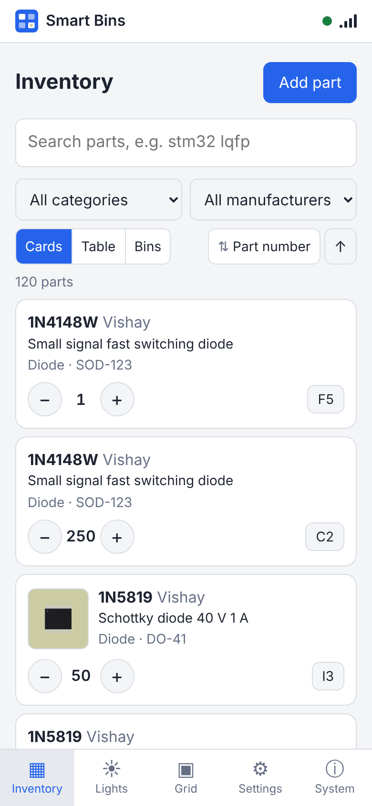
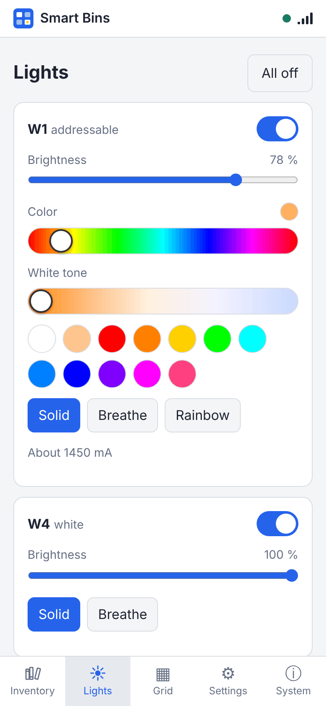
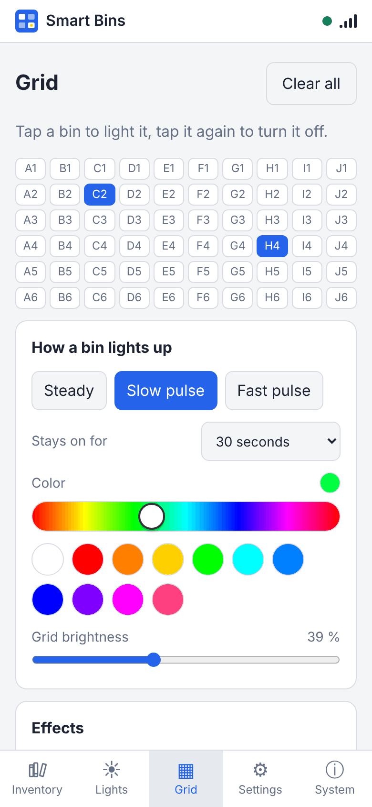
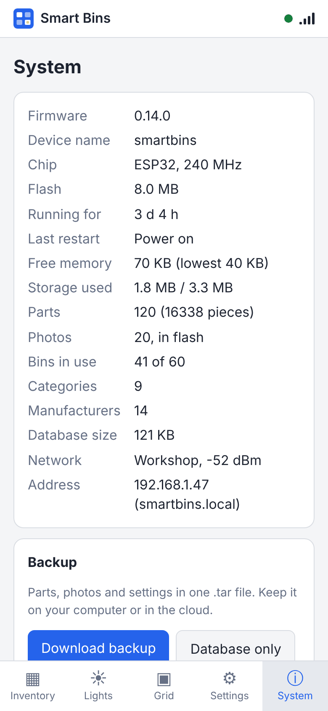

# Smart Bins user guide

This guide starts after the firmware is on the board ([Installing the firmware](flashing.md)) and the circuit is wired ([Hardware reference](hardware/README.md)).

## First start and Wi-Fi

1. On first boot (or when your network can't be reached) the board opens a Wi-Fi network named **SmartBins-XXXX**. The on-board LED blinks fast.
2. Join it from a phone or laptop. A setup page opens by itself; if not, browse to `http://192.168.4.1/`.
3. Pick your network, enter the password and press **Connect**. The page shows the address once connected.
4. From then on the board is at **http://smartbins.local/** on your network (or at the IP shown in the serial log and on your router).

The **BOOT** button on the board:

| Hold, then release | What happens | The status LED |
|---|---|---|
| 5s | forgets the Wi-Fi network (a fixed IP address goes back to automatic) and opens the setup network again | lights steadily |
| 10s | factory reset: Wi-Fi, settings, pin map and web password. The parts, photos and bins are kept. | flickers |

## The pages

The page works on phones and computers, in English, Spanish and Russian, with a light or dark theme (Settings). Changes made on one phone show up on every other open page at once; the dot in the top bar is green while that live connection is up.

### Inventory

- **Search as you type.** Every word must appear somewhere in the part (number, manufacturer, category, description, package, value, notes), in any case, also in Cyrillic and with accents: `stm32 lqfp` finds STM32 parts in LQFP packages. The category and manufacturer lists narrow it further; the sort button orders by part number, manufacturer, category and more.
- **Three views:** cards with **+ / −** quantity buttons, a table, and **Bins**, the grid with the matching bins marked. Tap a bin label on a card (`F5`) to light that bin. With **Light the bin when all results are in one bin** ticked, a search that narrows down to one bin lights it by itself.
- **Add part** / tap a part: the form for its fields, the bin, the quantity and a photo. Categories and manufacturers already in use are offered as you type.
- **Photos:** in the part form, **Add photo** takes one with the camera or picks one from the phone. The page turns it upright and shrinks it (640 px on the long side in flash, 800 px on a microSD card, plus a small thumbnail) before uploading. Tap a thumbnail to see the photo full size; tap again to close it.

### Lights

Every work light: on/off, brightness, and for color lights a color slider, a white-tone slider and 12 presets. Effects: **solid**, **breathe** and, for addressable strips, **rainbow**. Every change fades. Only the switch turns a light on or off: a brightness, color or effect picked while a light is off is used when it is switched on. The addressable strips show their estimated current, which follows the picture. The state is saved a few seconds after the last change and comes back, with a fade-in, after a restart. **All off** turns every light off.

### Grid

- Tap a bin to light it, tap it again to turn it off; **Clear all** turns every bin off.
- **How a bin lights up:** steady, slow pulse or fast pulse; how long it stays on; its color; the bin brightness (located bins only: effects have their own brightness). Changes apply at once, also to the bins lit now (a new color fades in; each bin keeps the time it was lit for), and are kept over a restart.
- **Effects** on the whole grid: **fire**, **sparks**, **relax** (slow, soft color fields) and **demo** (each in turn, 30s apart). With a microphone there are three music effects: **spectrum** (a bar per column, bass on the left), **beat** (a splash of color on every beat) and **pulse** (a glow from the middle that swells with the loudness). They adjust to the music's loudness by themselves; for them, intensity is the sensitivity. Speed, intensity, brightness and colors can be changed while an effect runs (every change fades in), and a timer stops it after 15 minutes to 4 hours. Every effect remembers its settings. Located bins always show on top of an effect. After a restart the grid comes back dark.
- **Test patterns** for checking the wiring (see [Setting up the grid](#setting-up-the-grid)).

### Settings

- **Language** and **theme**, saved in the browser.
- **Device name**: also the network address, `http://NAME.local/`.
- **Password** (off by default). Once set, the browser asks for it (user name `admin`), and over-the-air updates need it too. The Wi-Fi setup page on the board's own setup network stays open, so a board that lost its Wi-Fi can always be brought back. Forgot it? A 10s BOOT factory reset removes it.
- **Wi-Fi**: the network, and an automatic (DHCP) or fixed IP address.
- **LED grid**, **Work lights**, **Microphone and pins**: the hardware settings, see below. Saving restarts the board.
- **Advanced: configuration file**: `config.json` itself. Saving checks every field and restarts the board.

### System

- Firmware, chip, uptime, **Last restart** (see [Troubleshooting](#troubleshooting)), free memory (and free PSRAM on a board with PSRAM), storage, and the inventory figures.
- **Backup**: **Download backup** saves one `.tar` file with the parts database, every photo and the settings (any computer opens it: `tar -xf`, 7-Zip). **Download DB only** downloads the SQLite file.
- **Restore** takes a backup `.tar` (or a bare `.db`), replaces the parts, adds the photos and, if ticked, restores the settings. The database it replaces is kept and can be downloaded, so a restore can be undone.
- **Save DB to SD card** (with a card in the slot) copies the parts database and the settings to the `backups` folder on the card, named by date and time. **Restore from SD card** (enabled once a copy exists) opens a list of the copies, newest first; the chosen one replaces the parts like a restore from a file, and the current database is kept.
- **Also restore the settings** applies to a full backup and to an SD card copy; a bare `.db` file has no settings, and the page says they were kept.
- **Delete DB** removes every part after a warning; bins, settings and photos stay. The deleted database is kept like the one before a restore, so it can still be downloaded until the next restore or delete. **Remove unused photos** then clears the photos.
- **CSV export / import** for editing the parts in a spreadsheet (Export CSV asks for the separator, semicolon or comma, and the import reads either; a row whose `id` matches a part updates it, other rows add parts; bins are written like `A1`).
- **Photo storage**: moves photos from flash to a microSD card, and removes photo files no part uses.
- **Firmware update**: installs a release's `-update.bin` file (see [Installing the firmware](flashing.md#3-updating)).
- **Restart device**.

 

**Where photos go.** With a microSD card in the slot at boot, photos go on the card; without one they go to the flash, which keeps 512 KB free for the database. Photos stored in flash stay visible after a card is added, and **Photo storage** can move them.

## Setting up the hardware

### Setting up the grid

Under Settings → **LED grid**: columns and rows, pixels per bin (1–8), the wiring (**zigzag** or **every row from the same side**), where the first pixel is, one or two data lines (with two, the first rows go on line A and the rest on line B), the LED type, color order, supply voltage, current limit, current per pixel and fade time. The drawing below the fields shows the wiring order you have chosen; check it against your strip before saving.

**Current per pixel** is what one pixel draws at full white. The firmware uses it to estimate the strip's current and to keep it under the current limit. Left empty, it is the LED type's typical figure from the datasheet, which a real strip often stays well under, so the estimate reads high and the limit dims earlier than it needs to. To measure the real figure, press **Full white test**: every pixel lights at full white for 2 minutes, past the brightness and the current limit. Read the current at the power supply, divide it by the number of pixels, and enter the result.

Then use the **test patterns** on the Grid page:

| Test | What you should see |
|---|---|
| walk bins | one bin at a time, left to right, top to bottom. If the order jumps, fix the wiring or first pixel setting. |
| chain | a single green pixel running along data line A (blue on line B) in wiring order |
| rows / columns | one full row or column at a time |
| colors | the whole grid red, green, blue, white. If red shows as green, change the color order (RGB instead of GRB, for example). |

With a single-transistor (inverting) level shifter, tick **Inverted data**.

### Work lights

Under Settings → **Work lights**, each of the five channels is one of:

| Mode | Channels | What it drives |
|---|---|---|
| Off | any | nothing; the pin stays low |
| White (PWM) | W1–W5 | a plain single-color strip through its N-MOSFET |
| Part of the RGB strip | W1+W2+W3 together | an analog RGB strip: W1 red, W2 green, W3 blue |
| Addressable strip | W1–W3 | an addressable strip on that channel's data line, powered through the work-strip switch |

**Maximum brightness** caps a channel that is too bright for the room. Addressable channels also take the number of pixels, LED type, color order, current limit and current per pixel, and have their own **Full white test** for measuring it (see [Setting up the grid](#setting-up-the-grid)).

### LED supply on/off (PS-ON)

With a supply that has remote on/off and a standby output, such as the Mean Well EPP-300-12 ([hardware guide, section 7](hardware/README.md)), set the **LED supply on/off (PS-ON)** pin in Settings, Pins (GPIO2 in the guide, with the status LED set to –), and **LED supply power good (PG)** if it is wired (GPIO39). There is no switch for it: the supply's main output goes on as soon as any light needs it (a located bin, an effect, a test pattern or a work light) and off once every light has been dark for about 2.5 seconds. The LEDs get data only once the output is up: when PG goes high, or 500 ms after switching on without PG. The System page shows whether the supply is on.

### Motion sensor

A motion sensor on the analog microphone's pin (GPIO35 by default) works as a master switch: when nobody has been at the bench for a while, every work light and the grid's effect fade to dark, and when someone stays, they come back as they were. Wiring and suitable modules: [hardware guide, section 8](hardware/README.md#8-microphone-and-motion-sensor-optional).

- **Lights on after** (1–60s, 5 by default): the sensor has to see someone for this whole time. A person walking past or stopping for a moment doesn't keep it up, so the lights stay dark.
- **Lights off after** (1–240 min, 5 by default): the lights go dark once the sensor has seen nobody for this long. With a PIR sensor, which only notices movement, make it longer.
- The sensor never changes the lights' own settings. Which lights are on, their levels, colors and effects stay as you set them on the Lights page; a light you switched off stays off when you come back.
- While the sensor has everything dark, the Lights page and the Grid page's Effects show a notice with a **Turn back on** button.
- Located bins and test patterns still light up while nobody is sensed: you asked for them from a page.
- Switching a light or a grid effect on from a page (or **Turn back on**) brings everything back at once, and it stays on, with nobody sensed, until someone arrives and leaves again (or you switch it off): you may be switching it on from elsewhere.
- After a restart, the lights come on as they were and go dark after the off delay unless someone is sensed.
- With the LED supply switched by PS-ON (below), dark lights also mean the supply's main output is off.
- The Lights page shows whether someone counts as being at the bench and the sensor's output right now, which helps while aiming it.
- The sensor and the analog microphone share the pin, so turning the sensor on switches an analog microphone off.

### Microphone and pins

- **Microphone**: digital (I2S, an INMP441 or similar), analog (a MAX9814 or similar, on an ADC1 pin, GPIO32–39) or none. The board checks for it at start-up; without one the music effects stay hidden. The microphone and the music effects need a board with PSRAM (the 16 MB PSRAM build): on a board without it they are off and the choice is greyed out, so that the web server keeps enough memory, above all with a microSD card in the slot.
- **Pins**: the GPIO of every function. Each list offers only the pins the board can use for that function, and a pin chosen twice is marked. **Default pins** puts back the reference map. On the PSRAM build, GPIO16 and 17 are not offered: the PSRAM uses them.

If the board stops responding after a pin change, hold BOOT for 10s: the factory reset restores the default pins.

## Troubleshooting

**Last restart** on the System page says why the board last started:

| Shown | Meaning | What to do |
|---|---|---|
| Power on | it was switched on | nothing |
| Restarted | an update, a settings change, the restart button | nothing |
| Reset button | the EN button | nothing |
| Crash, Watchdog, Main loop stopped responding | a firmware fault; the board restarted by itself | please report it with the serial log if you have one |
| Supply voltage dropped (brown-out) | the 3.3 V supply sagged, usually during a Wi-Fi peak | check the 5 V feed, its wiring and the USB cable; see the hardware reference |

Faults are shown in red.

**The page can't be reached.** Check the board is on the same network (the router's client list, or the serial log). If `smartbins.local` doesn't resolve (some Android phones, Windows without Bonjour), use the IP address. After a Wi-Fi or IP change that went wrong, hold BOOT for 5s and set it up again.

**Wrong colors or order on the grid:** run the test patterns (above).

**The serial log** (115200 baud) explains most problems: the boot report lists the chip, flash, memory, partitions and pin map, and warns when the firmware doesn't match the board.
